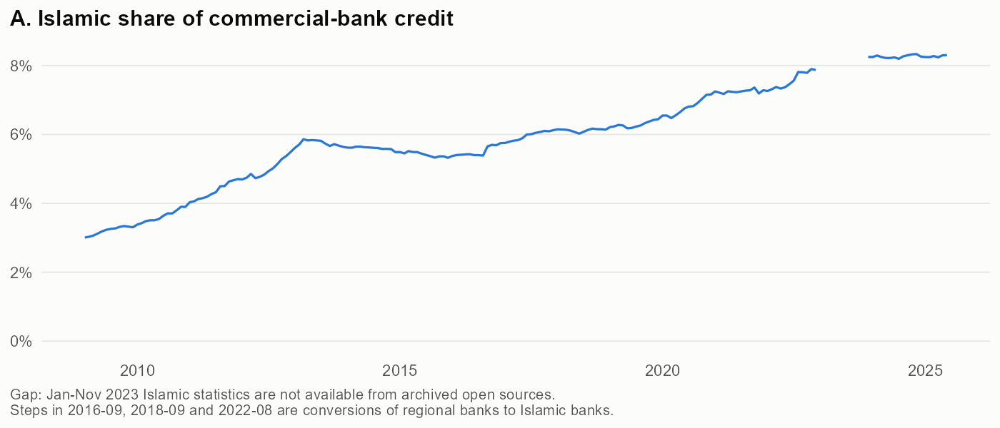
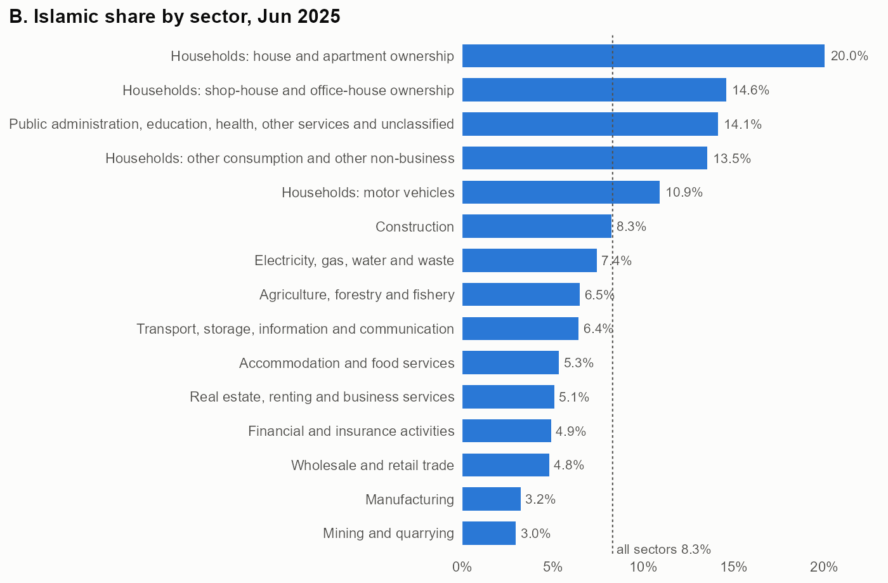
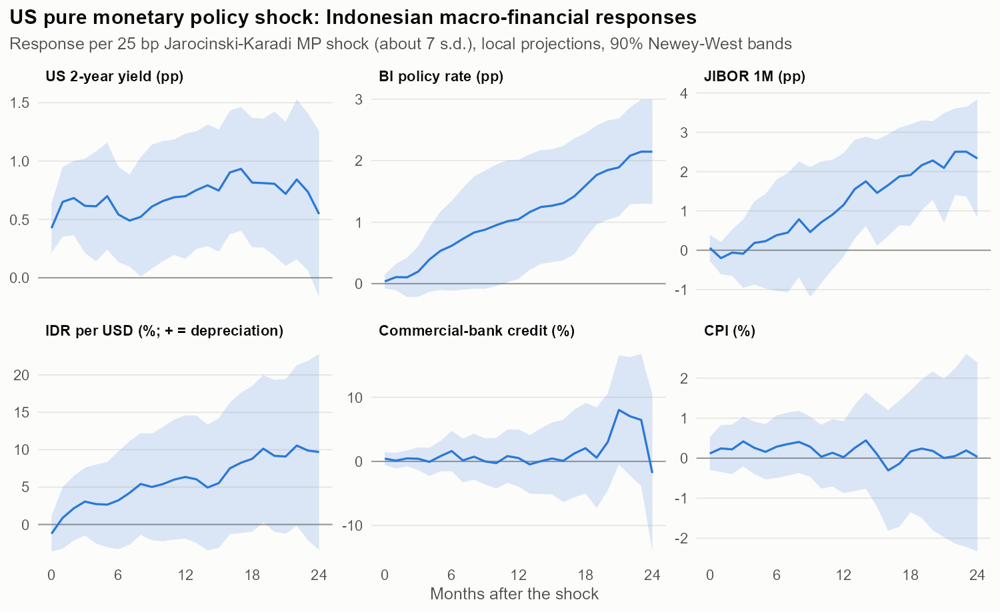
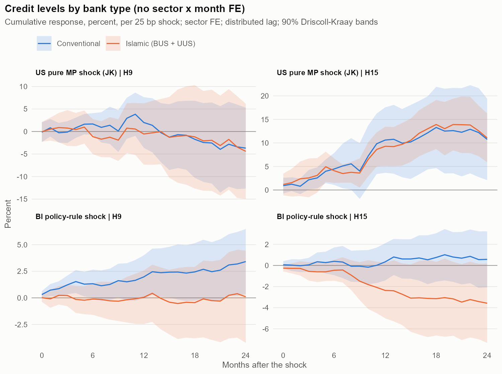
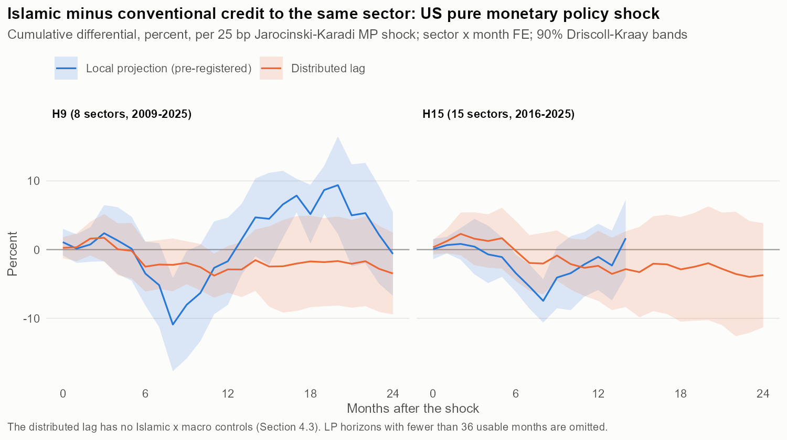
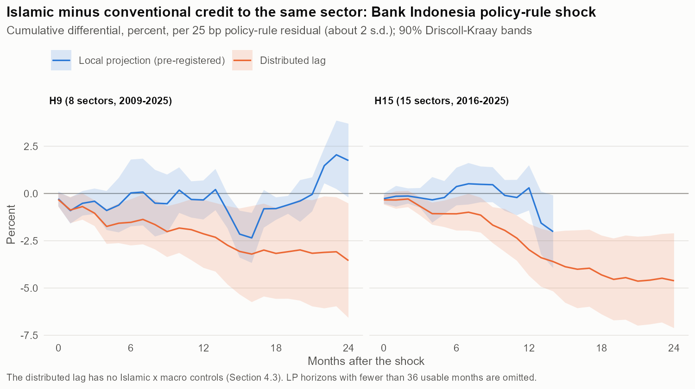
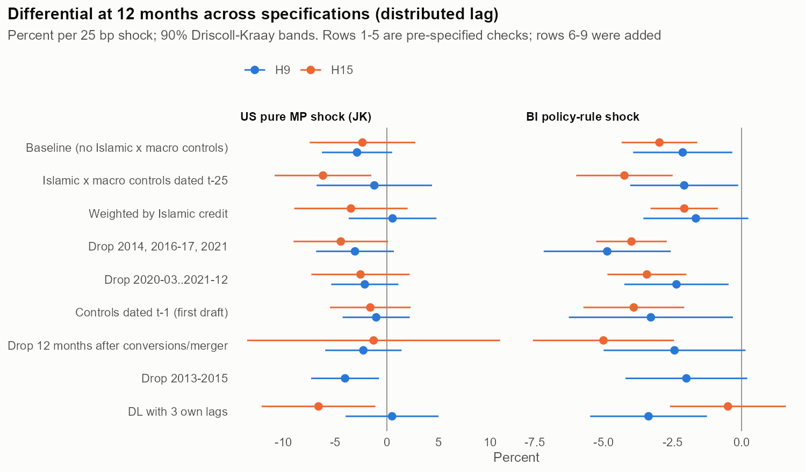
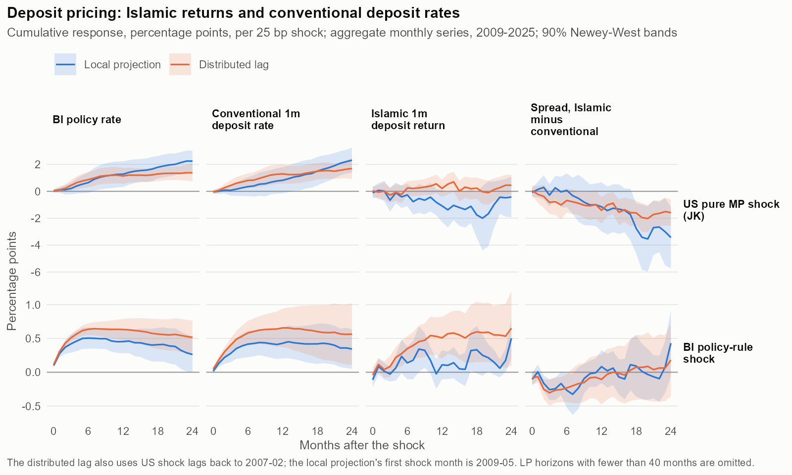
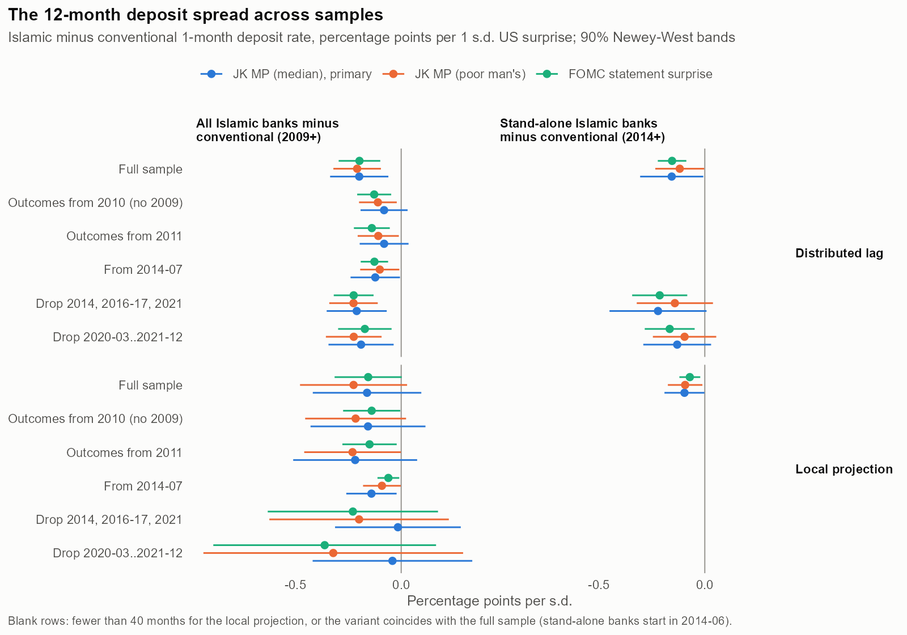
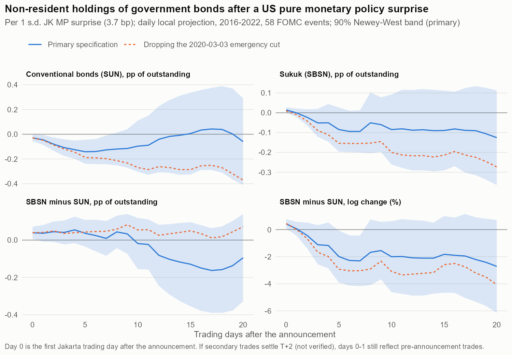

# Does Islamic Finance Change Monetary Transmission? Within-Sector Evidence from Indonesia's Dual Banking System

*Working paper, draft of 30 October 2026. Comments welcome.*

**Abstract.** Islamic banks may not pay or charge interest, so a growing Islamic banking sector could weaken or distort monetary transmission. This paper tests this in Indonesia with a new public monthly panel of credit by economic sector and lender type for 2009-2025. The design compares Islamic and conventional credit to the same sector in the same month, so that sector-month fixed effects absorb demand. It uses US high-frequency monetary policy shocks, which move Indonesian interest rates but are not driven by Indonesian credit conditions. The specification was fixed in a pre-analysis plan. A 25 bp US tightening, which raises Bank Indonesia's policy rate by about 1 pp within a year, changes Islamic relative to conventional credit by -1.7 percent after 12 months (s.e. 3.9). A distributed-lag estimator gives -2.9 (s.e. 2.1; nominal 90 percent band -6.3 to +0.5), so Islamic credit does not respond less than conventional credit, and a moderately larger contraction cannot be excluded. After domestic policy-rule shocks the distributed lag points to a 2-3 percent larger Islamic contraction, but the pre-registered estimator does not detect it and the main panel shows a pre-trend. The price channels that would create a difference are weak: Islamic deposit returns lag conventional rates only modestly, and after 2014 Islamic financing rates reprice like comparable conventional credit. Deposit flows are too noisy to test whether Islamic funding is squeezed. Daily data on government bond holdings cannot tell whether foreign holders of sovereign sukuk are more or less flighty than holders of conventional bonds. Regressions that interact shocks with sectoral Islamic penetration give large estimates of opposite sign in two panels and cannot separate penetration from other sector characteristics. In Indonesia, Islamic finance transmits monetary policy much like conventional finance; differences of a few percent of credit per 25 bp cannot be excluded.

**JEL codes:** E52, E44, F42, G21, Z12.

**Keywords:** Islamic banking, monetary transmission, dual banking, US monetary policy spillovers, local projections, Indonesia.

## 1. Introduction

Islamic banks may not charge or pay interest. Their deposits are nominally profit-sharing investment accounts, and their loans are mostly cost-plus sales with margins fixed at origination. Monetary policy works through interest rates. Does a banking system in which a growing share of credit is formally interest-free transmit monetary policy differently? The question matters for every central bank in a dual banking system: Indonesia, Malaysia, Pakistan, the Gulf, Turkey, Bangladesh and others. It also matters for how these economies absorb US monetary policy, which reaches emerging markets through their own interest rates and capital flows (Rey, 2013; Miranda-Agrippino and Rey, 2020; Kalemli-Özcan, 2019).

The existing evidence does not answer the question convincingly. Most studies estimate VARs on aggregate Islamic and conventional series, or interact the domestic policy rate with an Islamic-bank dummy in bank-level regressions. Both approaches face two problems:
- **Endogenous policy.** The policy rate responds to the credit conditions it is meant to explain.
- **Different borrowers.** Islamic and conventional banks lend to different borrowers. Islamic finance concentrates in household housing and consumer finance, which respond differently to rates whatever the lender's contract.

The literature reaches every possible conclusion. Islamic banks are found to be more sensitive (Kassim, Majid and Yusof, 2009), less sensitive (Caporale et al., 2020), or to behave like large conventional banks (Zaheer, Ongena and van Wijnbergen, 2013).

This paper studies Indonesia's dual banking system with a design built to address both problems.

**First, it compares Islamic and conventional credit to the same economic sector in the same month.**
- It constructs a monthly panel, 2009-2025, of credit by economic sector from three lender types: stand-alone Islamic banks, Islamic windows of conventional banks, and conventional banks.
- Sector x month fixed effects absorb sector demand, sector risk and the aggregate effect of the shock. This is the logic of Khwaja and Mian (2008), applied at the sector level, which is the finest level the public data allow.

**Second, it uses externally identified monetary policy shocks.**
- The primary shock is the Jarociński-Karadi (2020) pure monetary policy component of FOMC announcement surprises.
- Its identification does not depend on any Indonesian variable, and the paper shows it moves Indonesian interest rates: a 25 bp US surprise raises the Bank Indonesia policy rate by about 1 pp within a year.
- A domestic Bank Indonesia policy-rule shock is reported as a less credible complement.

**Third, the specification was written in a pre-analysis plan before any outcome was estimated.** Every deviation is reported. All data are public and downloadable, including archived copies of Indonesian statistics that are no longer online.

### Findings

**1. US monetary policy shocks do not detectably move Islamic and conventional credit to the same sector differently.**
- The pre-registered headline is a differential of -1.7 percent after 12 months per 25 bp tightening (s.e. 3.9). The plan's time-series version on the cross-sector average differential gives -0.1 (s.e. 2.4; block-permutation p = 0.98).
- A more precise distributed-lag estimator gives -2.9 percent (s.e. 2.1; permutation p = 0.33). Its negative sign leans on the early sample: with outcomes from 2011 it is +0.2.
- At the 12-month horizon none of the DL estimates for US policy shocks is significant under permutation, and no joint permutation test rejects. The plan's LP swings significantly at intermediate horizons (negative at 6-11 months, positive at 16-23), but the DL does not reproduce these swings, and the Monte Carlo shows the LP's bands are far too narrow. There is no pre-trend in the main panel, and its estimate is stable when any single sector or year is dropped. The shorter 2016-2025 panel is not.
- The nominal 90 percent band rules out Islamic credit falling more than about 6 percent more, or more than about 0.5 percent less, than conventional credit to the same sector per 25 bp (-0.9 to +0.1 percent per standard deviation of the shock). Insulation is the hypothesis the data come closest to excluding.

**2. After domestic shocks, Islamic credit may contract somewhat more.**
- The pre-registered LP estimate is small and insignificant, but the Monte Carlo shows that this estimator recovers less than half of a true differential for this shock.
- The distributed lag gives -2.1 percent per 25 bp in the main panel and -3.0 in the shorter one (permutation p = 0.055 and 0.010), robust to most checks. The main panel shows a pre-trend, and the shock is identified only by selection on observables, so this is suggestive rather than established.

**3. The channels behind a funding squeeze are weak or untestable.** Aggregate deposit and financing rates show:
- Conventional deposit rates pass Bank Indonesia's rate through one for one.
- Islamic deposit returns lag them modestly after US tightening, by about 0.1 pp per standard deviation of the shock. In the full sample only the distributed lag is significant, and for the primary shock it falls from -0.20 to -0.08 pp per standard deviation and loses significance without the 2009 outcome months.
- Deposits do not detectably flow out of Islamic banks, although the test has little power.
- After 2014, murabahah financing rates reprice no differently from comparable conventional consumer credit.

Nothing in these data points to a funding squeeze that would make Islamic credit contract more: the modest lag in Islamic returns is not followed by detectable deposit outflows.

**4. The sovereign market offers no evidence of a less flighty Islamic investor base.** In daily data, non-residents sell conventional government bonds in the week after US hawkish surprises. That finding is suggestive: it fails the events-only test and has a pre-announcement drift. Foreigners hold 5 percent of sukuk against 39 percent of conventional bonds, so by arithmetic sukuk lose less foreign funding relative to their size. Whether a foreign sukuk holder behaves differently from a foreign conventional-bond holder cannot be answered with these data.

**5. Penetration regressions are uninformative.** The obvious design for asking whether *heterogeneous sectoral penetration* matters interacts the shock with each sector's Islamic share. That design produces large estimates of opposite sign in two panels covering the same economy, far outside the within-sector bands. Controlling for household sectors does not remove them. With 8 or 15 sectors, these regressions cannot separate penetration from other sector characteristics or from within-sector spillovers. If there are no spillovers, the within-sector estimate bounds how much penetration can change a sector's response: up to about 1.5 percent per 25 bp at the highest penetration in the data.

### Contribution

The paper's first contribution is to the literature on Islamic banking and monetary policy. It is, to our knowledge, the first study in that literature to use externally identified shocks and to compare Islamic and conventional lenders within the same borrower segment. The answer, no detectable difference after US shocks and at most a modestly larger Islamic contraction after domestic ones, is consistent with the mimicry view that Islamic banks in practice price and fund like conventional banks (Chong and Liu, 2009; Khan, 2010) and is inconsistent with the insulation view.

The second contribution is methodological, and applies beyond Islamic finance. Public sector-level data are riddled with breaks from reclassifications, conversions and missing months. With such data, local projections that drop contaminated windows lose most of their long-horizon sample. A distributed-lag estimator on clean monthly changes recovers the same impulse response with about a third of the sampling variability for the US shock, and without the local projection's attenuation for the domestic shock. A Monte Carlo on the actual design shows this, and also shows that standard Driscoll-Kraay inference is anti-conservative, so permutation tests are needed. Distributed lags need one more care: macro controls dated relative to the outcome month are post-treatment and should be left out.

### Limitations

The design identifies the *differential* response of Islamic and conventional credit within sector-months, and only at the sector level. It cannot rule out differences between borrowers within a sector. Its bands are wide enough that moderate differences, a few percent per 25 bp, remain possible. Bank-level or loan-level data from the credit registry of the Financial Services Authority (OJK) would sharpen the answer considerably.

## 2. Institutional background and hypotheses

### 2.1 Indonesia's dual banking system

Indonesia has had a dual banking system since Law 10/1998 allowed conventional banks to open Islamic units alongside full-fledged Islamic banks (the first, Bank Muamalat, began operating in 1992). The Islamic Banking Act of 2008 (Law 21/2008) gave Islamic banking its own statute. Islamic financing is supplied by two kinds of institutions:

- **Islamic commercial banks (*Bank Umum Syariah*, BUS)** are stand-alone banks with their own balance sheets, capital and funding. Their number grew through new licences, spin-offs of Islamic windows, and the conversion of three regional development banks: Bank Aceh (September 2016), Bank NTB (September 2018) and Bank Riau Kepri (August 2022). In February 2021 the three Islamic subsidiaries of state-owned banks merged into Bank Syariah Indonesia.
- **Islamic business units (*Unit Usaha Syariah*, UUS)** are Islamic windows inside conventional banks. They keep separate Islamic books but sit inside a conventional parent, so they can draw on the parent's funding and internal capital market.

Both are supervised by the Financial Services Authority (OJK), which publishes Islamic banking statistics monthly. Bank Indonesia (BI) sets monetary policy for the whole system. Its main instrument was the BI Rate until August 2016 and has since been the BI 7-day reverse repo rate (BI-7DRR, renamed the BI-Rate in December 2023). Islamic banks take part in monetary operations through Shariah-compliant instruments (Bank Indonesia Sharia Certificates, Shariah repo and term deposits). The returns on these instruments are benchmarked to the policy rate.

The Islamic share of commercial-bank credit rose from 3.0 percent in January 2009 to 8.3 percent in June 2025 (Figure 1A). Penetration is very uneven across sectors (Figure 1B):
- In household housing finance, Islamic banks supply about a fifth of all credit.
- In shop-house finance, social services and other household lending, they supply 13-15 percent.
- In manufacturing and mining, they supply about 3 percent.

*Figure 1A. Islamic share of commercial-bank credit, 2009-2025 (H9 panel, all sectors).*

*Figure 1B. Islamic share of commercial-bank credit by sector, June 2025 (H15 panel).*

### 2.2 Why transmission could differ

The claim that Islamic banks transmit monetary policy differently rests on their contracts.

**Funding.** Most Islamic deposits are *mudharabah* investment accounts. Depositors are owed a share of realised returns, not a pre-set interest rate. The rest are *wadiah* (safekeeping) demand and savings accounts, which pay discretionary bonuses. If returns follow the bank's realised income, they should adjust to a change in policy rates only as the bank's asset yields reprice. On the asset side, the dominant contract is *murabahah*, a cost-plus sale with a margin fixed at origination, so asset yields reprice slowly. Two predictions follow, and they point in opposite directions:

1. **A funding-squeeze channel.** After a tightening, conventional deposit rates rise faster than Islamic returns. Return-sensitive Islamic depositors move to conventional banks. Islamic funding then falls relative to conventional funding, and so does Islamic credit. Stand-alone BUS should feel this more than UUS, which can be funded by the parent. In the literature this is the "withdrawal risk" or "displaced commercial risk" that pushes Islamic banks to match conventional deposit rates. It is the Islamic-banking counterpart of the deposits channel of Drechsler, Savov and Schnabl (2017), in which deposit pricing drives how banks transmit policy.
2. **An insulation channel.** Fixed murabahah margins make Islamic financing relatively cheap right after a tightening, and profit-sharing liabilities absorb part of the shock. Islamic credit would then fall *less* than conventional credit.

**The counter-hypothesis is mimicry.** Competition for the same depositors, and pricing benchmarked to conventional rates, may make Islamic banks price, fund and lend much like conventional banks. Chong and Liu (2009) and Khan (2010) give evidence of this, and Beck, Demirgüç-Kunt and Merrouche (2013) find few significant differences in business orientation between Islamic and conventional banks. In that case the contract form would not change transmission at all.

**International shocks add a further margin.** A US tightening reaches Indonesia through the exchange rate, capital flows, global risk appetite and BI's own reaction. The investor base for Islamic assets is different from the conventional one: it includes domestic Islamic banks, Shariah funds and Gulf and Malaysian Islamic investors. If that base is less inclined to flee after a US tightening, Islamic intermediaries would be shielded from the capital-flow leg of the global financial cycle.

### 2.3 What the existing evidence can and cannot say

The empirical literature on Islamic banks and monetary policy mostly estimates VARs on aggregate Islamic and conventional series, or bank-level regressions of loan growth on the policy rate interacted with an Islamic dummy. Examples include Kassim, Majid and Yusof (2009) and Sukmana and Kassim (2010) for Malaysia, Zaheer, Ongena and van Wijnbergen (2013) for Pakistan, and several Indonesian studies. On the risk side, Abedifar, Molyneux and Tarazi (2013) find Islamic banks' loan quality less responsive to domestic interest rates. Two problems recur:

- **The policy rate is not exogenous.** It responds to the credit and demand conditions that also drive loan growth.
- **Islamic banks lend to a different mix of borrowers than conventional banks.** Their customers are disproportionately households, real estate and services, so an "Islamic" coefficient partly measures borrower composition.

This paper addresses both:
- Monetary policy is measured with externally identified US high-frequency shocks, with a domestic policy-rule residual as a secondary shock.
- Islamic and conventional credit are compared *within the same sector and month*, so that borrower composition and sector-wide demand are absorbed by fixed effects.

To our knowledge, no published study of Islamic banking and monetary transmission combines externally identified shocks with a comparison of Islamic and conventional lenders within the same borrower segment.

## 3. Data

Every input is publicly available online without registration. Appendix A gives each file's provenance, including the Internet Archive copies used for OJK statistics that are no longer on OJK's website. All construction code reruns end to end from the raw files.

### 3.1 Credit by sector and bank type

**Islamic financing by sector.** OJK's *Statistik Perbankan Syariah* (SPS) reports Islamic financing and non-performing financing (NPF) by economic sector every month. BUS and UUS are combined from January 2009 to May 2014 and reported separately from June 2014. The series is assembled from five archived editions (December 2014, June 2015, December 2018, December 2024 and June 2025). Where they overlap (12,582 sector x bank-type x month cells), the editions report identical financing in every cell; the only difference is one NPF total cell (January 2018), an error in the later editions that is corrected. The old and new sector classifications agree exactly on 12 overlap months once aggregated. No edition with January-November 2023 data is archived, so those 11 months are missing for all Islamic series.

**Total credit by sector.** Table I.4 of Bank Indonesia's Indonesian Economic and Financial Statistics (SEKI) reports credit, in rupiah and foreign currency, by economic sector and bank group, covering all banks including rural banks (BPR). Commercial-bank credit is the SEKI total minus the BPR group.

**Conventional credit** is commercial-bank credit minus Islamic financing. This requires SEKI to include Islamic financing, which its documentation does not state, so the paper tests it (Appendix A.2):
- **Stand-alone Islamic banks (BUS): the evidence is decisive.**
  - Commercial-bank credit shows no jump at the footnoted May 2014 coverage change. If BUS had entered then, underlying credit growth that month would have been -3.1 percent, below every other month of 2009-2025.
  - When OJK reclassified Islamic shop-house financing in July 2014, SEKI's shop-house line moved by almost exactly the same amount (-11.0 tn against -11.2 tn).
  - When two whole regional banks converted to Islamic banks (Bank Aceh, Bank Riau Kepri), SEKI's regional-bank group did not lose them.
- **Islamic windows (UUS): the evidence is strong but indirect.** OJK's all-bank statistics, which explicitly include Islamic windows, match SEKI's household credit within 0.15 percent, while UUS household financing alone is about 120 tn.

**Two sector panels.** Sectors are harmonised into two panels with an explicit crosswalk:
- **H9** covers 2009-01 to 2025-06 and has eight consistent sectors: agriculture, mining, manufacturing, utilities, construction, trade, transport, and services-plus-households. Households cannot be separated from business services consistently before 2014 because OJK's old "business services" line contains household property financing. The plan named this panel H9 before the households-services merge reduced it to eight sectors, and the paper keeps that name.
- **H15** covers 2016-06 to 2025-06 and has 15 sectors, including four household sectors (housing, shop-house, vehicles, other).

Table 1 describes both panels.

**Contamination flags.** Each sector x bank-type monthly change gets a flag, `adj_growth_ok`. It is false when the change is contaminated by any of the following:
- a reporting or classification break, either footnoted by the publisher (BI: 2014-05, 2024-03, 2025-01; OJK: 2014-05) or identified in the data (BI: 2010-01/02; OJK: 2014-07, 2015-03), or the 2017-07 splice of the old and new SEKI sector classifications in H9;
- a bank conversion (all sectors, all Islamic and conventional series);
- a merger;
- a one-month spike that fully reverses, identified with a noise-scaled rule;
- a missing neighbouring month.

About 6 percent of monthly changes are flagged. Several of the flagged events hit every unit at once: the three conversions, three classification changes and the 2023 gap. This matters for estimation (Section 4.3).

Two independent audits re-derived every one of the 16,095 panel cells from the raw workbooks with their own parsers. All differences were documented corrections of OJK source errors. One example: January 2018, where the published UUS block is exactly twice the correct value.

### 3.2 Monetary policy shocks

**US shocks.** The primary international shock is the **pure monetary policy** component of the Jarociński-Karadi (2020) decomposition of FOMC surprises (median rotation, updated to 2026). It removes the central-bank-information component that moves interest rates and stock prices in the same direction. Robustness uses four alternatives:
- the "poor man's" sign-restriction version (MP_pm);
- the statement and monetary-event surprises from the San Francisco Fed's US Monetary Policy Event-Study Database (USMPD; Acosta et al., 2025);
- the orthogonalised surprise of Bauer and Swanson (2023), available to 2023.

The information component (CBI) is reported as a contrast. Event-level surprises are summed within the calendar month. Over 2009-2025 the monthly JK pure-policy shock has a standard deviation of 3.5 bp, so the pre-registered reporting unit of 25 bp is about seven standard deviations (Table 2). Every estimate is linear in the shock, so this choice only rescales point estimates and standard errors; per-standard-deviation magnitudes are reported alongside.

**Domestic shock.** The domestic shock is the residual of a monthly BI policy rule. The change in the policy rate is regressed on:
- three of its own lags;
- lagged CPI inflation and manufacturing-production growth;
- two lags of the change in the IDR/USD rate;
- the lagged change in the VIX, the US 2-year yield and Brent;
- the contemporaneous US shock.

The policy rate is adjusted for the August 2016 switch from the BI Rate to the BI-7DRR, which lowered the headline rate by 125 bp without any easing. Over 2006-2026 the rule has R² = 0.48. The residual has a standard deviation of 13 bp, and 72 percent of its variance falls in months in which BI actually changed its rate. Identification here rests on selection on observables. The plan graded this shock as less credible than the US shock before any outcome was estimated.

### 3.3 Mechanism data

- **Islamic rates.** OJK reports Islamic deposit returns by contract and tenor and equivalent financing rates by contract, use and sector. Use and sector rates start in 2014-06.
- **Conventional rates.** SEKI reports commercial banks' rupiah time-deposit rates by tenor (I.28) and lending rates by use (I.26). The tables do not say whether Islamic banks' equivalent rates are included. They are treated as conventional rates; any inclusion of Islamic rates would bias the Islamic-minus-conventional spreads slightly towards zero.
- **Funding volumes.** OJK reports Islamic third-party funds (DPK) by instrument. Conventional deposits are SEKI table I.17's private deposits at commercial banks minus Islamic DPK. As on the credit side, this requires SEKI to include Islamic deposits. A level comparison with OJK's all-bank statistics shows it includes BUS deposits: the two totals differ by 0.3 to 0.4 percent, against a BUS deposit base of 5.5 to 5.8 percent of the total. UUS inclusion is assumed.
- **Government bond holdings.** The Ministry of Finance's Directorate General of Budget Financing and Risk Management (DJPPR) published daily holdings of tradable government bonds by holder and instrument, separately for conventional bonds (SUN) and sovereign sukuk (SBSN). The archived files cover 2015-12 to 2022-06.

## 4. Empirical strategy

### 4.1 The within-sector comparison

Let $y_{s,b,t}$ be log credit to sector $s$ from bank type $b \in \{\text{ISL}, \text{CONV}\}$ in month $t$, where ISL = BUS + UUS is all Islamic financing and CONV is conventional credit, and let $\varepsilon_t$ be a monetary policy shock. The estimand is the **differential** cumulative response of Islamic relative to conventional credit to the same sector:

$$
\begin{aligned}
y_{s,b,t+h} - y_{s,b,t-1} = {} & \beta_h\,(\varepsilon_t \times \text{ISL}_b) + \alpha_{s,t} + \alpha_{s,b} \\
 & + \sum_{l=1}^{3}\gamma_l\,\Delta y_{s,b,t-l} + \text{ISL}_b \times X_{t-1}'\delta + u_{s,b,t+h}.
\end{aligned} \tag{1}
$$

The terms in (1) are:
- **Sector x month fixed effects** $\alpha_{s,t}$. They absorb everything that moves credit to a sector in a month: sector-specific demand, sector-wide risk, and the aggregate effect of the shock itself. This applies the within-borrower logic of Khwaja and Mian (2008) at the sector level. Within a sector-month, Islamic and conventional lenders face the same demand conditions, so $\beta_h$ isolates the lender side up to residual composition within sectors.
- **Sector x bank-type fixed effects** $\alpha_{s,b}$. They absorb permanent growth differences, for example the faster trend growth of Islamic finance.
- **Lagged growth and lagged controls.** Three lags of own monthly growth (lag augmentation, as in Montiel Olea and Plagborg-Møller, 2021), and the macro controls $X$ (VIX, Brent oil growth, IDR/USD growth and the BI rate) dated $t-1$, before the shock, interacted with the Islamic dummy. The interactions absorb any differential cyclicality of Islamic credit with respect to these variables.

Identification needs $\varepsilon_t$ to be uncorrelated with whatever else moves the Islamic-minus-conventional gap in a sector. For the US high-frequency shocks this is plausible: FOMC surprises measured in 30-minute windows are not driven by Indonesian Islamic-credit conditions. Two concerns remain. The first is a US shock that coincides with an Indonesia-specific Islamic event; the paper tests this with leads, by dropping event windows, and by permutation. The second is mechanical: both credit series include foreign-currency loans valued in rupiah, and Islamic banks hold a much smaller foreign-currency share than conventional banks. A US tightening that weakens the rupiah therefore raises measured conventional credit relative to Islamic credit, and sector x month fixed effects do not absorb this. Section 6.4 estimates the size of this valuation effect.

### 4.2 Pre-analysis plan

The specification, panels, controls, shocks, inference, checks and the headline number were written down before any outcome regression was run (notes/pre_analysis_plan.md, dated 2026-10-29). The headline is $\beta_{12}$ in H9 for a 25 bp JK pure-policy tightening, with its 90 percent band. The plan also pre-specifies:
- the secondary estimands: levels by bank type, BUS vs UUS, sector exposure, mechanisms, NPF and domestic shocks;
- the checks: leads, the CBI contrast, dropping break years, dropping the pandemic, and power;
- three outcomes that would undermine a positive finding:
  - dependence on one sector;
  - sensitivity to the controls;
  - a pre-trend.

Appendix B lists every deviation from the plan.

### 4.3 Estimation: local projections and a distributed-lag deviation

The plan estimates (1) as a local projection (LP; Jordà, 2005) for $h = 0, \dots, 24$. It drops any window $[t-1, t+h]$ that contains a contaminated change.

This rule turned out to be costly. Seven contamination events hit every unit at once: the three conversions, three classification changes, and the 2023 gap. Together they cut the sample into short clean stretches. In H9 the LP sample falls from 2,244 observations at $h=0$ to 1,043 at $h=12$ (about 92 months) and 552 at $h=24$. Long-horizon LP estimates therefore rest on a small and selected set of months.

As a **deviation** from the plan, the paper also reports a distributed-lag (DL) estimator. It regresses each *clean* monthly change on current and lagged shocks:

$$
\Delta y_{s,b,t} = \sum_{k=0}^{24}\phi_k\,(\varepsilon_{t-k}\times\text{ISL}_b) + \alpha_{s,t} + \alpha_{s,b}
 + e_{s,b,t}, \qquad \beta^{DL}_h = \sum_{k=0}^{h}\phi_k. \tag{2}
$$

Under exogenous and serially uncorrelated shocks, (1) and (2) target the same impulse response, much as local projections and VARs do in population (Plagborg-Møller and Wolf, 2021). The DL loses only the contaminated months themselves, not every window that contains one. Equation (2) has no Islamic x macro controls. In a DL, controls are dated relative to the outcome month, so $X_{t-1}$ would come after the shock for every lag $k \ge 1$; since the BI rate, the rupiah and the VIX all respond to US shocks, such controls would net out part of the effect being measured. With exogenous shocks they are not needed for consistency. The first draft of this paper did include them; Table 6 reports that version and one with the controls dated $t-25$, before every shock lag. A Monte Carlo on the actual H9 design checks both estimators (Section 6.3). The design uses the real units, months, contamination pattern and shock series.

### 4.4 Inference

The shock varies only over time, so the effective sample is the number of months.
- **Main standard errors.** Driscoll and Kraay (1998), with bandwidth $h+2$ for the LP and 12 for the DL.
- **Time-series check.** The plan also asks for a time-series regression on the cross-sector average differential, with Newey-West (1987) errors.
- **Permutation tests.** These re-assign the shock series across months in blocks of 12 calendar months (2,000 draws), on that average differential. They give p-values for $\beta_{12}$, and for the joint null that all 25 DL lag coefficients are zero. The permutation version replaces a Driscoll-Kraay Wald test, which is badly oversized with 25 restrictions and fewer than 200 months (Section 6.3).
- **Power.** For a null result the paper reports the minimum detectable effect at 5 percent size and 80 percent power, $2.80 \times \text{s.e.}$, and calls an imprecise null "uninformative".

## 5. Results: credit

### 5.1 US monetary policy reaches Indonesian interest rates

Before asking whether Islamic credit responds differently, it helps to see what a US shock does to Indonesian financial conditions (Figure 2, Table 3). A 25 bp JK pure-policy tightening:
- raises the US 2-year yield by 0.43 pp on impact, which confirms the shock moves US rates;
- raises the BI policy rate gradually, by 1.05 pp after 12 months (s.e. 0.59) and 2.15 pp after 24 months (s.e. 0.52);
- raises the one-month Jakarta interbank offered rate (JIBOR) by a similar amount;
- weakens the rupiah, though the estimates are imprecise.

The USMPD statement surprise gives the same picture, more precisely estimated relative to its size: the BI rate rises 1.99 pp after 12 months (s.e. 0.70; t = 2.8 against 1.8 for the JK shock). In standard-deviation units the BI response is modest: about 0.15 pp after 12 months per one-s.d. JK shock. It is nonetheless clearly present. US tightening is imported into Indonesian rates, mostly through Bank Indonesia's reaction.

*Figure 2. Indonesian macro-financial responses to a 25 bp US pure monetary policy shock (time-series local projections).*

Aggregate commercial-bank credit shows no detectable response to the JK shock at any horizon. It rises after the USMPD statement shock (5.0 percent after 12 months, s.e. 1.8). Positive level responses also appear in the bank-type level regressions: after the JK shock in H15, both Islamic and conventional credit rise by about 9-11 percent at 12 months (Figure 3). These are not credible causal credit responses. Credit is measured in rupiah, and foreign-currency loans are revalued upward when the rupiah weakens. Time-series level responses over 198 months also mix the shock with the few large tightening episodes (2013, 2018, 2022). The within-sector differential does not depend on level responses: sector x month fixed effects absorb the episode-specific demand conditions. They do not absorb the valuation effect, because Islamic and conventional lenders hold very different foreign-currency shares within a sector; Section 6.4 discusses it.

*Figure 3. Credit levels by bank type, without sector x month fixed effects (distributed lag).*

### 5.2 The main result: no detectable differential after US shocks

Table 4 and Figure 4 report the differential response of Islamic relative to conventional credit to the same sector.

**The pre-registered headline.** In H9, a 25 bp JK pure-policy tightening changes Islamic credit relative to conventional credit by **-1.7 percent after 12 months (s.e. 3.9; 90 percent band -8.0 to +4.7)**. The plan's time-series version on the cross-sector average differential gives -0.1 (s.e. 2.4, 78 months; block-permutation p = 0.98). The lead placebo, growth over the four months *before* the shock, is 1.3 (s.e. 1.8).

**The distributed-lag estimate points the same way and is about twice as precise:**
- $\beta_{12} = -2.9$ percent (s.e. 2.1), or -0.40 percent per standard deviation of the shock;
- 90 percent band -6.3 to +0.5;
- lead placebo -0.6 (s.e. 1.9);
- permutation p-value for $\beta_{12}$ on the average differential 0.33;
- for the joint null that the shock has no differential effect at *any* horizon up to 24 months, permutation p-value 0.71.

In H15 (15 sectors, 2016-2025) the estimates are -1.1 (LP, s.e. 2.9) and -2.4 (DL, s.e. 3.1). In H15 both placebos are positive and borderline (LP 2.5, s.e. 1.4; DL 2.5, s.e. 1.3), one more reason that panel adds little (Section 6.2).

**Other US shocks (Table 5).** At 12 months, none of the US policy-shock DL estimates is significant under the permutation test (the smallest p-value is 0.11, for the FOMC statement surprise in H9: -6.7, s.e. 3.7), and no joint permutation test rejects (p from 0.20 to 0.83). The DL point estimates are mostly negative, from -6.7 to +5.1 percent per 25 bp. Under the plan's LP one 12-month estimate is significant: the USMPD monetary-event surprise in H15, -3.1 (s.e. 1.3); its DL counterpart is -3.7 (s.e. 4.5), with a permutation p-value of 0.47 on the average differential. The Bauer-Swanson surprise, available to 2023 and estimable in H9 only, is uninformative (DL +5.1, s.e. 5.2; LP +7.1, s.e. 7.8). The central-bank-information component also shows no differential.

**Intermediate horizons.** The plan's LP swings significantly at intermediate horizons for every US shock: for the JK shock in H9, -10.9 percent (s.e. 4.1) at 8 months and +5 to +9 percent at 16-20 months (Figure 4). Across four US shocks, 25 horizons and two panels, 47 of the 160 LP estimates resting on at least 36 months are significant at 5 percent. The more precise DL gives 6 of 200, about what chance produces, and does not reproduce the swings. The Monte Carlo of Section 6.3 shows that nominal 90 percent LP bands cover the truth only 49 to 76 percent of the time and that its long windows are few and selected, so the LP swings are not read as effects.

**What the data can rule out.** These are uninformative nulls in one sense: they cannot distinguish "no difference" from a moderate difference. The DL minimum detectable effect at 12 months is 5.8 percent per 25 bp in H9, or 0.81 percent per one-s.d. shock (computed the plan's way, from the average differential, 6.3). The nominal 90 percent band excludes Islamic credit falling more than 6.3 percent more, or more than 0.5 percent less, than conventional credit per 25 bp. Scaling the standard error up by the Monte Carlo's ratio of true to estimated sampling variability (1.34) widens this to -7.4 to +1.7. Insulation, Islamic credit falling materially less than conventional credit, is the hypothesis the data come closest to excluding; a moderate funding squeeze is not excluded.

*Figure 4. Islamic minus conventional credit to the same sector after a US pure monetary policy shock: pre-registered LP and DL.*

### 5.3 The domestic shock: a negative differential in the distributed lag

For the domestic policy-rule shock the two estimators disagree (Table 4, Figure 5):

- **The pre-registered LP gives a small, insignificant estimate.** In H9, $\beta_{12} = -0.34$ percent per 25 bp (s.e. 0.63); in H15 +0.30 (s.e. 0.73). The Monte Carlo (Section 6.3, Table 11) shows that this LP is strongly attenuated for this shock: when the true differential builds to -2.4, its mean estimate is -1.1 at 12 months. Its zero therefore cannot by itself rule out a differential of the size the DL finds.
- **The DL gives a negative differential in both panels.** At 12 months it is -2.1 percent (s.e. 1.1) in H9 and -3.0 (s.e. 0.8) in H15, about -1.1 and -1.5 percent per standard deviation; at 24 months -3.6 and -4.6. The permutation p-values for $\beta_{12}$ are 0.055 and 0.010; the joint permutation test over all horizons does not reject (p = 0.53 and 0.68).

The DL estimate is robust to most checks (Tables 6 and 10): it stays between about -1.1 and -5.0 when the Islamic x macro controls are added, when single sectors or single years are dropped, when the sample starts in 2010 or 2011, when the pandemic, break years or the 12 months after each conversion are dropped, and when own lags are added in H9. Taken at face value, it says Islamic credit contracts about 2-3 percent more than conventional credit to the same sector after a 25 bp domestic tightening, which raises the BI rate by about 0.5 pp within a year.

Three caveats keep this from being a firm result.
1. **A pre-trend in H9.** The lead placebo is +1.9 (s.e. 0.8): Islamic credit was growing faster than conventional credit *before* BI tightenings. The policy rule does not absorb whatever drives the Islamic-conventional growth gap, which fits the plan's grading of this shock as selection on observables. In H15 the lead is smaller and insignificant (0.8, s.e. 0.7).
2. **The pre-registered estimator does not find it.** The LP's attenuation explains part of the gap, not all of it.
3. **The channel evidence does not point to a funding squeeze.** After domestic shocks Islamic deposit returns catch up with the BI rate within a year and Islamic deposits do not detectably fall relative to conventional deposits (Section 7). The BUS/UUS split cannot help: conversions move whole books between UUS and BUS (Section 5.4).

**Conclusion on domestic shocks.** There is suggestive evidence that Islamic credit contracts modestly more than conventional credit after domestic tightening. It rests on the deviation estimator and a shock identified by selection on observables, and the main panel shows a pre-trend.

*Figure 5. Islamic minus conventional credit to the same sector after a Bank Indonesia policy-rule shock.*

### 5.4 Funding structure: BUS versus UUS

The plan proposed BUS versus UUS as the test of the funding channel. With public aggregates this test is not informative (Table 7). For US shocks both differentials are imprecise: at 12 months in H9, BUS is -5.7 (s.e. 6.4) and UUS is +5.3 (s.e. 8.8). The UUS differential is also fragile: dropping the post-conversion windows moves it from +6.3 to +29.6 in H15 and from +5.3 to +20.8 in H9.

The reason is mechanical. Each conversion and spin-off reallocates whole loan books between the UUS and BUS aggregates, so their separate growth rates reflect industry reorganisation more than lending decisions. Separating the two would require bank-level data, which OJK does not publish openly by sector.

### 5.5 Sectoral penetration: why penetration regressions mislead

The plan's sector-exposure regression asks whether sectors with more Islamic penetration see different total-credit responses ($\theta_h$, Table 8). Under the composition identity, with no substitution between lenders and a common differential, $\theta_h$ should equal $\beta_h$. It does not, and it is not stable:
- In H15, $\theta_{12}$ for the JK shock is **+41.5 (s.e. 18.1)** against $\beta_{12} = -2.4$.
- In H9 it is **-90.8 (s.e. 45.0)** against $\beta_{12} = -2.9$.

Both estimates reject $\theta = \beta$ at the 10 percent level, with opposite signs, in two panels that cover the same economy. Penetration is not assigned at random across sectors. In the 2016-17 pre-period that defines the H15 exposure, it is highest in social services (15.8 percent), household housing (14.6) and shop-house finance (11.3); in H9, households are merged with services. But household composition does not explain $\theta$: adding a household x shock term raises $\theta_{12}$ in H15 to 55.7 (s.e. 17.9), and leaving out one sector at a time keeps it between 26.6 and 76.4 (76.4 without housing). In H9, dropping the services-plus-households sector moves it to -113.

With 8 or 15 sectors, these regressions cannot separate penetration from other sector characteristics, or from within-sector substitution and spillovers, which is the plan's pre-registered reading of $\theta \ne \beta$. The lesson is negative but useful: the obvious way to study "heterogeneous penetration" with sector or regional aggregates, interacting the shock with the local Islamic share, gives large and unstable estimates. The within-sector comparison avoids this, at the price of measuring only the direct, lender-level difference.

That lender-level difference bounds the composition effect, but only if there are no within-sector spillovers, which the $\theta$ test does not support. Under that assumption and a common differential across sectors, the H15 band for $\beta_{12}$ (-7.5 to +2.7) implies that 20 percent penetration, the highest in the data, could change a sector's 12-month credit response by up to about 1.5 percent per 25 bp at nominal 90 percent confidence, or about 1.8 with the Monte Carlo correction.

### 5.6 Credit risk

Islamic non-performing financing ratios show no response to the domestic shock until the 12-month horizon, where they rise slightly (Table 9): 0.48 pp per 25 bp in H9 (s.e. 0.18) and 0.21 pp in H15 (s.e. 0.09). After US shocks the NPF ratio *falls* at 12 months. This is unlikely to be a causal improvement in credit quality: it is a level regression without time effects and is subject to the same episode and denominator concerns as the level credit responses. The paper reports these results because they are pre-specified and draws no conclusion from them.

## 6. Robustness and inference

### 6.1 Pre-specified checks

Table 6 and Figure 6 report the 12-month differential under the plan's checks and four that were added after the data were seen. The plan listed three outcomes that would undermine a positive result:
- dependence on one sector;
- sensitivity to the Islamic x macro controls;
- a pre-trend.

The main US result is a null, so for it these checks ask whether the null hides an effect. They do not suggest one:
- The DL $\beta_{12}$ for the JK shock stays between -4.0 and +0.6 in H9 across all nine DL specifications. Only one, dropping 2013-2015 (-4.0, s.e. 2.0), is significant.
- Adding the Islamic x macro controls moves it towards zero: -1.2 (s.e. 3.4) with controls dated t-25, -1.0 (s.e. 2.0) with the first draft's controls dated t-1.
- H15 is less stable. With controls dated t-25 it is -6.2 (s.e. 2.8), and with three own lags -6.6 (s.e. 3.3), but dropping the post-conversion windows gives -1.3 (s.e. 7.4). The plan's LP cannot be estimated in H15 once break years, the pandemic or the post-conversion windows are dropped, because fewer than 36 usable months remain.

For the domestic DL estimate, the checks mostly confirm the sign:
- In H9 it ranges from -1.7 (weighted, s.e. 1.2) to -4.9 (dropping break years, s.e. 1.4). The plan's section-7 criterion, a significant estimate that disappears when the Islamic x macro controls are added, is not met: with controls dated t-25 it is -2.1 (s.e. 1.2).
- In H15 every check is negative and significant except the DL with three own lags (-0.5, s.e. 1.3).
- The H9 lead placebo is significant (Section 5.3), which is the main reason the estimate is not read as causal.

*Figure 6. The 12-month differential across specifications (distributed lag).*

### 6.2 Leave one sector out, leave one year out

**Sectors.** No single sector drives the estimates (Table 10). Dropping one sector at a time keeps the H9 DL $\beta_{12}$ for the US shock between -4.5 and -0.6, and the domestic one between -2.6 and -1.5.

**Years.** The DL regresses each month's change on 25 shock lags, so the first outcome months of H9 (2009) draw on shocks from 2007 and 2008, which the LP never uses. These include some of the largest Fed surprises in the sample. Section 7 shows that one mechanism result depends on this.
- **US shock, H9.** With outcomes from 2010 the DL $\beta_{12}$ is -1.3 (s.e. 2.7). With outcomes from 2011, so that every shock lag falls in 2009 or later, it is +0.2 (s.e. 2.7). Leaving out one calendar year at a time keeps it between -4.5 and -1.3, and no estimate has $|t| > 1.9$. The negative point estimate of the full-sample DL therefore leans partly on the early years.
- **Domestic shock, H9.** The DL estimate is -2.7 (s.e. 1.2) from 2010 and -2.6 (s.e. 1.2) from 2011. Leaving out one year keeps it between -3.4 and -1.1.
- **US shock, H15.** This panel covers only nine years, and its DL estimate depends on which ones are included. Leaving out 2016 to 2020, 2024 or 2025 keeps it between -2.9 and +1.0. Leaving out 2021 gives -5.5 (s.e. 2.9). Leaving out 2022 gives **-14.7 (s.e. 2.5)**. The 2021 merger and the 2022 conversion fall in those two years, and with so few years the panel cannot separate the US shocks from these events. The pre-registered headline is the H9 estimate. H15 agrees with it in the full sample but adds little information.

These swings are large relative to the reported standard errors, and the Monte Carlo below shows that the Driscoll-Kraay standard errors are too small. A single year's removal producing a large $t$ in a nine-year panel should be read as fragility, not as a hidden effect.

### 6.3 How good are the estimators? A Monte Carlo on the actual design

Inference in this setting is delicate. There are 8 or 15 sectors, fewer than 200 months, all-unit contamination events, and a shock that varies only over time. The paper therefore checks its estimators by simulation on the actual H9 design:
- the real units, months, contamination pattern and shock series;
- simulated growth rates with a sector-month common component;
- a bank-type-specific AR(1) error, with innovation standard deviations set to the observed monthly growth volatility;
- either no differential effect, or a differential that builds to -2.4 percent per 25 bp over 12 months.

The DL in the simulation is the paper's baseline DL, without Islamic x macro controls. Table 11 reports 300 draws per design. Three results matter for the paper.

1. **The DL estimator is unbiased. For the US shock it is far more precise than the plan's LP; for the domestic shock the LP is attenuated.**
    - JK shock, 12 months: DL bias -0.2 or less and standard deviation 4.5 to 4.8; LP standard deviation 14.0 to 14.4. The LP loses precision because the contamination rule discards most long windows.
    - Domestic shock: the DL is not more precise (standard deviation 2.1 to 2.2, against 2.0 for the LP at 12 months), but the LP is biased towards zero. When the true differential builds to -2.4, the LP's mean estimate is -1.1 at 12 months and -0.5 at 24 months, while the DL's is unbiased.
2. **Driscoll-Kraay standard errors are too small for both estimators.** Nominal 90 percent bands cover 74 to 83 percent of the time for the DL and 49 to 76 percent for the LP. For the DL, the true spread of the estimates is 17 to 35 percent larger than the average reported standard error. This widens the range of differences the US nulls leave open, and overstates the significance of the domestic DL estimate. The permutation tests in Table 5 do not rely on these standard errors.
3. **The Driscoll-Kraay Wald test of all 25 lag coefficients rejects a true null in 300 of 300 draws for the US shock and 299 of 300 for the domestic shock.** With 25 restrictions and fewer than 200 months, the estimated covariance matrix is far too noisy for a joint test. This is why the paper's joint tests are permutation-based.

The simulation's noise level is set by the raw volatility of monthly growth, which includes predictable components. Its absolute standard deviations are therefore larger than the standard errors in Table 4. The comparisons between estimators, and the coverage rates, are the informative quantities.

### 6.4 Foreign-currency valuation

Both credit series include foreign-currency loans valued in rupiah. Islamic banks hold about 3 percent of their financing in foreign currency (OJK SPS: 6.1 percent in 2015, 3.2 percent in 2025). For all commercial banks the figure is roughly 12 to 14 percent (Bank Indonesia financial soundness indicators), which implies about 13 to 15 percent for conventional banks. A rupiah depreciation after a US tightening therefore raises measured conventional credit relative to Islamic credit, pushing the measured differential negative; sector x month fixed effects do not absorb this.

A back-of-the-envelope calculation gives the size. The foreign-currency share gap of about 11 percentage points, times the 6.4 percent depreciation per 25 bp at 12 months in Table 3, is a mechanical bias of about -0.7 percent per 25 bp, and about -1.1 at 24 months. The depreciation estimate is itself imprecise (s.e. 5.0). A bias of this size would move the H9 DL estimate for the US shock from -2.9 to about -2.2, which strengthens the null; it is small for the domestic shock, which barely moves the rupiah. A full valuation adjustment needs foreign-currency credit by sector and lender type, which this draft does not yet construct.

## 7. Channels: deposit pricing, funding and financing rates

The credit results say that Islamic and conventional credit to the same sector respond alike. This section asks whether the price and funding variables behind credit respond alike too. The funding-squeeze hypothesis predicts a chain:
1. Islamic deposit returns, set ex post from bank income under profit-sharing contracts, adjust more slowly than conventional deposit rates after a tightening.
2. Rate-sensitive depositors then move to conventional banks.
3. Islamic banks lose funding and cut credit.

A parallel asset-side hypothesis is that murabahah margins, fixed at origination, reprice slowly. That would make Islamic financing relatively cheap after a tightening.

This module is descriptive. It uses aggregate monthly series: OJK's Islamic deposit returns, financing margins, deposits (DPK) and ratios, and Bank Indonesia's commercial-bank deposit rates, lending rates and deposit volumes, treated as conventional (Section 3.3). There are no sector-month fixed effects, so the comparison is between two time series. Identification rests on the exogeneity of the shock alone. Each outcome is estimated with the same LP and DL estimators as Section 5, without sector fixed effects. Standard errors are Newey-West, and pass-through ratios use the delta method. The code is `code/R/13_mechanisms.R`. Appendix A.3 documents how the source copy errors in the OJK rate files were neutralised.

### 7.1 Deposit pricing

**Conventional deposit rates pass policy through fully.** After a domestic shock the conventional 1-month deposit rate tracks the BI rate one for one: the DL pass-through ratio is 1.04 (s.e. 0.24) at 12 months (Table 12, Figure 7). After a US shock the BI rate rises by 1.15 pp (s.e. 0.36) per 25 bp at 12 months, and the conventional deposit rate rises by 1.30 pp (s.e. 0.43). US tightening therefore reaches conventional depositors through BI's reaction, as Section 5.1 found for market rates. For the primary shock this response also depends on 2009: without the 2009 outcome months it is 0.68 (s.e. 0.49), against a BI-rate response of 0.97 (0.54), and this conventional leg accounts for most of the spread's sensitivity to 2009 discussed below. For the poor man's and statement shocks it is stable (1.10 and 2.12 pp).

*Figure 7. Deposit pricing: BI policy rate, conventional 1-month deposit rate, Islamic 1-month deposit return and their spread.*

**Islamic returns follow the BI rate after domestic shocks, more slowly.** Islamic 1-month mudharabah returns pass through 0.56 (s.e. 0.18) of the BI rate at 6 months and 0.82 (s.e. 0.34) at 12. The Islamic-minus-conventional spread dips by 0.30 pp per 25 bp at 3 months (s.e. 0.12) and closes within a year: -0.11 (s.e. 0.22) at 12 months. The LP shows a pre-trend in the spread (-0.18, s.e. 0.09), so even this transitory dip is not cleanly identified.

**After US shocks the spread falls, but the evidence is fragile (Table 13, Figure 8).** In the full sample the DL gives a spread of -1.41 pp per 25 bp at 12 months (s.e. 0.60), or -0.20 pp per standard deviation of the shock. The other US series have the same sign: -1.47 (0.48) for the JK poor man's shock and -2.20 (0.67) for the FOMC statement surprise. The lead placebo passes for all three, and the block permutation p-value is 0.018. Three findings temper this.
- **In the full sample the LP is not significant at the pre-registered 12-month horizon.** It gives -1.15 (s.e. 1.11), -1.59 (1.08) and -1.74 (1.08) for the three shocks, on 88 months.
- **The significance for the primary shock rests on one year.** The DL regresses the 2009 outcome months on shock lags reaching back to 2007, and the 2007-08 Fed surprises are large: in sum of squares the 23 months from 2007-02 to 2008-12 carry 67 percent as much variation as all 198 months of 2009-2025. Dropping the 2009 outcome months gives -0.58 (s.e. 0.48). Starting the outcomes in 2011, so that every shock lag falls in 2009 or later, gives the same -0.58 (0.50). Leaving out any other single year keeps the estimate between -1.68 and -1.30. Figure 8 shows the sample variants.
- **Outside 2009 the effect is about half as large.** Without 2009 the poor man's shock and the statement surprise still give significant spreads, -0.78 (s.e. 0.38) and -1.42 (s.e. 0.54) per 25 bp. That is -0.11 and -0.13 pp per standard deviation, against -0.20 in the full sample. From mid-2014 all three shocks give about -0.1 pp per standard deviation.

By the plan's own standard, a significant estimate that disappears when one unit is dropped is undermined (plan section 7 states this for sectors; one year is the time-series analogue). The sign is robust: the spread is negative for every US shock in every sample variant, except one insignificant LP estimate on 2009-2014 alone. The honest summary is that Islamic deposit returns probably lag conventional deposit rates after US tightening by a modest amount, about 0.1 pp per standard deviation of the shock. In the full sample only the distributed lag measures this with any precision; from mid-2014 the LP is also significant at 10 percent, -1.00 (0.52), -0.64 (0.38) and -0.68 (0.35) on 40 months.

*Figure 8. The 12-month deposit spread across sample variants, per standard deviation of three US shocks.*

The cleanest version of the result is for stand-alone Islamic banks after 2014, where the 2009 problem cannot arise. Their spread against conventional banks is significant in both estimators at 12 months for all three pure US shocks: LP -0.68 (s.e. 0.41), -0.65 (0.35) and -0.79 (0.33), on 49 months; DL -1.11 (0.65), -0.83 (0.50) and -1.72 (0.46). Lead tests pass. But the sample is short. Only the statement surprise survives the plan's checks of dropping break years or the pandemic, and the LP permutation p-value for the primary shock is 0.18.

**The information shock is a warning, not corroboration.** The Fed's central-bank-information component (CBI) gives a spread response of the same sign. It also fails the lead tests for the spread (p = 0.09) and for the BI rate (p = 0.055), flips sign in the LP at 24 months, and moves the BI rate twice as much per standard deviation as the pure policy shock. An information surprise should not move Indonesian rates more than a policy surprise. That pattern suggests the aggregate DL partly picks up common global-cycle co-movement between Fed news and Indonesian rates. The same concern applies, in smaller measure, to every US-shock result in this section. It applies less to the credit differential of Section 5, where sector x month fixed effects absorb anything common to both lender types, though not their different foreign-currency exposure (Section 6.4).

**Windows versus stand-alone banks.** The plan predicted that Islamic windows (UUS), which can draw on their conventional parent's funding, would price deposits more like conventional banks than stand-alone banks (BUS) do. The direct BUS-minus-UUS return gap supports this only at 3 to 6 months and only in the DL: -0.83 (s.e. 0.39) and -1.15 (0.43) per 25 bp. At 12 months the gap is -0.49 (0.76) in the DL and -0.14 (0.36) in the LP. Only the statement surprise gives a significant 12-month gap, -1.46 (s.e. 0.67) in the DL and -0.33 (s.e. 0.19) in the LP. The UUS return rises in the DL (1.89, s.e. 0.51) but not in the LP (-0.55, s.e. 0.59). This is suggestive at most.

### 7.2 Deposit flows and funding

The second link fails, or rather cannot be tested (Table 14). The Islamic-minus-conventional growth differential of deposits rises on impact after a US tightening, by 2.8 percent per 25 bp in the DL (s.e. 1.6). That is the wrong sign for an outflow. From 7 months on the LP is positive and the DL negative (at 12 months 7.95, s.e. 5.64, against -3.71, s.e. 3.34), and neither is robust: the LP estimates fail the plan's sample checks and reverse sign in 2009-2014. The minimum detectable effect at 12 months is 9.3 percent per 25 bp, or 1.3 percent per standard deviation of the shock. The data therefore cannot tell rate-insensitive Islamic depositors from moderate outflows.

The financing-to-deposit ratio (FDR) rises in the DL after US shocks, but its lead tests fail. Funding-side evidence on the squeeze hypothesis is thus missing rather than negative. What can be said is that the step from the deposit-rate spread to the credit differential, which a funding squeeze requires, does not appear in the data at the precision available.

### 7.3 Financing rates

**After 2014, murabahah rates reprice no more slowly than comparable conventional credit (Tables 12 and 14).** In the full sample the murabahah equivalent rate falls after US tightening while the conventional working-capital rate rises, so the spread between them is -1.41 pp per 25 bp at 12 months (s.e. 0.43). This result comes from 2009 and the old-format OJK tables before mid-2014. Without 2009 the spread is -0.75 (s.e. 0.43). From mid-2014 the murabahah rate itself is flat (0.02, s.e. 0.40), and the spread against working capital is -0.53 (s.e. 0.39) only because working-capital rates rise.

The conventional consumer-loan rate is the closer comparator for murabahah, most of which finances household purchases. From mid-2014 it does not move either, and the spread against it is about zero (0.18, s.e. 0.49). In the full sample this spread is -0.84 (s.e. 0.37), but it is insignificant without the 2009 outcome months (-0.48, s.e. 0.58). On the same months, the Islamic financing rate for working capital passes through at least as much as the conventional working-capital rate (0.60, s.e. 0.34, against 0.21, s.e. 0.04). After 2014 the evidence is of slow repricing of fixed-margin consumer credit by both kinds of lender. Islamic financing does not become cheaper than comparable conventional credit.

### 7.4 Contract mix and credit risk

Nothing is robust here. The murabahah share of Islamic financing shows no robust response: apart from isolated cells (the information shock's LP at 6-12 months, the statement surprise on impact) it is insignificant, and its lead tests fail for two US series. The profit-sharing share falls after domestic shocks in the LP but not in the DL. The aggregate Islamic NPF ratio rises in the DL after domestic shocks (0.27 pp at 12 months, s.e. 0.13) but falls in the LP at 24 months (-0.29, s.e. 0.13).

### 7.5 What the channels say about the credit result

The evidence on mechanisms is weaker than the credit evidence, and it should be read that way. These are aggregate time series with few independent tightening episodes. They were estimated over about 110 series, five shocks and five estimators. Of all that, one deposit-pricing result survives: Islamic deposit returns lag conventional deposit rates after US tightening by about 0.1 pp per standard deviation of the shock.

Three readings of that lag remain open, and none is tested here.
- **A cost advantage.** Islamic banks pay depositors less than conventional banks after a tightening. This would cushion their funding costs only if asset yields held up, and bank margins are not measured.
- **Profit-sharing pass-through.** Mudharabah returns are set from realised income. If asset yields lag, returns lag too, with no implication for bank profitability.
- **Common global co-movement** picked up by the aggregate DL, as the information-shock diagnostics suggest.

What the module does show is that the funding-squeeze chain cannot be followed past its first link. Islamic returns do lag, modestly. But deposits do not detectably flow out, so there is no evidence that the lag squeezes Islamic funding. Murabahah pricing does not diverge from comparable conventional credit after 2014 either. That is consistent with the null credit differential, but it cannot be said to explain it.

## 8. The international investor base: sukuk versus conventional government bonds

US monetary policy reaches emerging markets partly through foreign portfolio investors, who sell local-currency bonds when US rates rise. If Islamic finance attracts a different, less flighty investor base, Islamic instruments would transmit US shocks less. Indonesia allows a clean test of this. The government issues both conventional bonds (SUN) and sovereign sukuk (SBSN). They share the issuer, credit risk, currency and trading calendar. Comparing foreign holdings of the two on the same day holds macroeconomic news and the exchange rate fixed.

This module is supplementary: the pre-analysis plan does not mention it (Appendix B, item 9). Its results should be read as exploratory.

### 8.1 Design

The data are the Ministry of Finance's (DJPPR) daily holdings of tradable rupiah government bonds by holder type, at face value, from 31 December 2015 to 27 June 2022. Over this period non-residents held on average 38.9 percent of SUN but only 4.7 percent of SBSN. SBSN is held mainly by domestic banks and insurers, and Islamic banks hold about 9 percent of it.

For each instrument, the outcome is the change in non-resident holdings from the day before an FOMC announcement to $h$ trading days after it, in percentage points of the instrument's outstanding stock. This scaling is robust to new issuance. A proportional (log) version is also reported. The estimator is an all-trading-day local projection. It has the following elements:
- the JK pure-policy surprise on the event day and zero on other days;
- five lags of the outcome's daily change;
- counts of settlement days in the window, because new issues settle on Thursdays and most announcements reach Jakarta on a Thursday;
- Newey-West errors and a permutation test that re-draws event dates.

Day 0 is the first Jakarta trading day after the announcement. The sample has 58 events. Identification rests on those events, not on the roughly 1,550 trading days.

### 8.2 Results

**Foreign investors may sell conventional bonds in the week after a US tightening (Table 15, Figure 9).** Per one-s.d. surprise (3.7 bp), non-resident SUN holdings fall by 0.08 pp of SUN outstanding by day 2 (s.e. 0.03) and 0.14 pp by day 5 (s.e. 0.06), about Rp 3 trillion. Newey-West p-values are 0.015 and 0.017, and permutation p-values 0.007 and 0.008. The day-5 estimate survives dropping any single event. The evidence is suggestive rather than established, for three reasons.
- The events-only cross-section, a check chosen before the results, does not reject: -0.11 (s.e. 0.08) at day 5.
- The pre-announcement placebo in the full sample is uninformative, not clean. Its minimum detectable effect, 0.18 pp, exceeds the effect it is meant to rule out. Excluding March-April 2020, the US shock predicts SUN selling in the five days *before* the announcement (-0.07, s.e. 0.03; Newey-West p 0.03, permutation p 0.14; excluding 2020-03 to 2021-12, -0.09, s.e. 0.03, permutation p 0.10). Dropping only the 3 March 2020 emergency cut gives -0.06 (s.e. 0.04).
- What happens after day 5 depends on one event, the emergency cut of 3 March 2020. With it, the outflow fades by day 20. Without it, the outflow keeps building to -0.37 pp (s.e. 0.14).

*Figure 9. Non-resident holdings of SUN and SBSN after a US pure monetary policy surprise (daily local projections).*

**The sukuk comparison is uninformative.** In pp of outstanding, the SBSN-minus-SUN differential is +0.04 per s.d. at day 5 (s.e. 0.04). Its minimum detectable effect is 0.12, and it is insignificant at every horizon after day 0. Its positive sign is what pure composition produces: with foreigners holding 5 percent of SBSN against 39 percent of SUN, equal *proportional* selling would move SBSN outstanding much less. The SBSN response itself cannot distinguish "no selling" from "selling like SUN holders": its 90 percent interval at day 5, -0.20 to +0.03, contains both.

In proportional terms the differential is -2.0 percent per s.d. at day 5 (s.e. 1.2, p = 0.09). That point estimate says foreign sukuk holdings fall proportionally *more*. It is not credible evidence of that either. Its minimum detectable effect is 3.3 percent, about 8.5 times the SUN response itself. In the samples where it is significant, the pre-announcement log differential has the opposite sign (+2.3, s.e. 1.0). A rise before the event followed by a fall is what mean reversion looks like in a tiny, noisy series: daily log changes of foreign SBSN holdings have a standard deviation of 3.1 percent.

**Domestic Islamic holders.** Islamic banks' SBSN holdings show no response in the first week (-0.02 pp of SBSN outstanding per s.d. at day 5, s.e. 0.03). At days 15-17 they rise by about 0.15 pp per s.d., and the 90 percent band just excludes zero; with 15 holder series and 21 horizons, this is not interpreted. The estimate is uninformative rather than zero: its minimum detectable effect at day 20 is about 19 percent of their own position per 25 bp, or about 2.8 percent per standard deviation of the shock. DJPPR does not separate Shariah mutual funds from other funds.

### 8.3 Interpretation

The sovereign market offers no evidence that the Islamic investor base is less flighty, and no evidence that it is more flighty. Foreigners hold so little sukuk that, by arithmetic, any proportional foreign selling moves the sukuk market less than the conventional market. That follows from ownership shares, not from different investor behaviour. Whether a foreign sukuk holder behaves differently from a foreign SUN holder cannot be answered with 58 events and a foreign sukuk base of about Rp 19 trillion.

The module also illustrates a design point. FOMC surprises in this period correlate with pre-meeting conditions that already move emerging-market portfolio flows. Daily data reveal this through the pre-announcement placebo; monthly data cannot. Any event study of EM bond flows on Fed surprises should report such a placebo.

## 9. Discussion and conclusion

### 9.1 Answers to the research question

The paper asked whether, to what degree, through what channels and with what consequences Islamic finance changes the transmission of domestic and international monetary policy shocks. For Indonesia, 2009-2025, the answers are as follows.

**Whether.** Not detectably after US shocks: they move Islamic and conventional credit to the same sector by amounts the data cannot tell apart. After domestic shocks there is suggestive evidence that Islamic credit contracts somewhat more, from the distributed-lag estimator only and with a pre-trend in the main panel.

**To what degree.** The data bound the difference. Per 25 bp of US tightening, which raises Bank Indonesia's rate by about 1 pp within a year, the nominal 90 percent band excludes Islamic credit to a sector falling more than about 6 percent more, or more than 0.5 percent less, than conventional credit to the same sector (about -7.4 to +1.7 after correcting for the Driscoll-Kraay understatement). After domestic tightening the point estimate is a 2-3 percent larger Islamic contraction. If there are no within-sector spillovers, heterogeneous sectoral penetration can then change a sector's credit response by up to about 1.5 percent per 25 bp at current penetration levels. Islamic finance in Indonesia, 8.3 percent of commercial-bank credit in June 2025, does not change aggregate transmission by a detectable amount.

**Through what channels.** The paper looked for the funding-squeeze chain and the fixed-margin chain and found neither established:
- Islamic deposit returns lag conventional deposit rates after US tightening, but modestly and imprecisely.
- Deposit flows are too noisy to test whether Islamic funding is squeezed.
- After 2014, murabahah rates reprice like comparable conventional consumer credit.
- The sovereign sukuk data cannot tell whether foreign sukuk holders are more or less flighty.

**With what consequences.** For Bank Indonesia, the growth of Islamic banking has not weakened the bank lending channel: Islamic credit to a sector responds to imported tightening like conventional credit, and if anything somewhat more strongly to domestic tightening, though differences of a few percent per 25 bp cannot be excluded either way. For research, the obvious design for studying penetration, interacting shocks with sector or regional Islamic shares, gives large, unstable estimates that cannot separate penetration from other sector characteristics or from spillovers.

### 9.2 Why might Islamic banks transmit like conventional banks?

The results fit the mimicry view (Chong and Liu, 2009; Khan, 2010). Indonesian Islamic banks are small relative to the conventional system and compete with it for the same depositors and borrowers. Their deposit returns and financing margins are reported as "equivalent rates", so customers can compare them directly with conventional rates. A small bank competing on comparable prices will set them close to the market, whatever the contract's legal form. The modest lag in Islamic deposit returns is consistent with this: returns are set from realised income, so they follow market rates, with a delay.

Nothing in the paper tests this explanation directly. Bank-level data on margins, funding costs and deposit pricing would be needed, and OJK does not publish them openly by bank and sector.

### 9.3 Limitations

- **Aggregation.** The design compares Islamic and conventional credit within sector-months, the finest level the public data allow. Differences between borrowers within a sector, for example between small and large firms, could still matter.
- **Power.** The bands exclude large differences but not moderate ones, a few percent per 25 bp. The Driscoll-Kraay standard errors are, if anything, too small, which widens the range of differences the data cannot exclude.
- **Shocks.** A 25 bp US surprise is about seven standard deviations of the monthly series, so per-25 bp magnitudes are linear extrapolations. The domestic shock is a policy-rule residual and shows pre-trends.
- **Valuation.** Both credit series include foreign-currency loans, which Islamic banks hold much less of; the differential is not yet adjusted for exchange-rate revaluation (Section 6.4).
- **Mechanisms.** The channel evidence uses aggregate time series with few tightening episodes, and the significance of its main result for the primary shock depends on the 2009 sample months.
- **Data.** Islamic statistics for January to November 2023 are not available from archived open sources. Several OJK files contain copy errors, which the paper neutralises rather than corrects.
- **External validity.** Indonesia's Islamic share is small. Where Islamic banks hold a third or more of the market, as in Malaysia or the Gulf, they may set prices rather than follow them. The within-sector design could be applied there with equivalent data.

### 9.4 Conclusion

Islamic finance is often expected to change monetary transmission, because its contracts formally exclude interest. In Indonesia it does not insulate credit from monetary policy. Islamic and conventional credit to the same sector respond alike to US shocks, within the precision of the public data, and Islamic credit may contract somewhat more after domestic tightening. The deposit-pricing and financing-rate channels that would create a difference are weak, and the funding channel cannot be measured precisely enough to test. The contract form appears to matter less than the market in which Islamic banks compete.

The design and the public data assembled here could be extended in three directions:
- loan-level data from OJK's credit registry, which would allow a borrower-level within comparison;
- bank-level data, which would separate Islamic windows from stand-alone Islamic banks;
- the same design applied to dual banking systems in which Islamic banks have larger market shares.

## References

Abedifar, P., Molyneux, P., & Tarazi, A. (2013). Risk in Islamic banking. *Review of Finance*, 17(6), 2035-2096.

Acosta, M., Ajello, A., Bauer, M. D., Loria, F., & Miranda-Agrippino, S. (2025). Financial market effects of FOMC communication: Evidence from a new event-study database. Federal Reserve Bank of San Francisco Working Paper 2025-30.

Bauer, M. D., & Swanson, E. T. (2023). A reassessment of monetary policy surprises and high-frequency identification. *NBER Macroeconomics Annual*, 37, 87-155.

Beck, T., Demirgüç-Kunt, A., & Merrouche, O. (2013). Islamic vs. conventional banking: Business model, efficiency and stability. *Journal of Banking & Finance*, 37(2), 433-447.

Caporale, G. M., Çatık, A. N., Helmi, M. H., Menla Ali, F., & Tajik, M. (2020). The bank lending channel in the Malaysian Islamic and conventional banking system. *Global Finance Journal*, 45, 100478.

Chong, B. S., & Liu, M.-H. (2009). Islamic banking: Interest-free or interest-based? *Pacific-Basin Finance Journal*, 17(1), 125-144.

Drechsler, I., Savov, A., & Schnabl, P. (2017). The deposits channel of monetary policy. *Quarterly Journal of Economics*, 132(4), 1819-1876.

Driscoll, J. C., & Kraay, A. C. (1998). Consistent covariance matrix estimation with spatially dependent panel data. *Review of Economics and Statistics*, 80(4), 549-560.

Jarociński, M., & Karadi, P. (2020). Deconstructing monetary policy surprises: The role of information shocks. *American Economic Journal: Macroeconomics*, 12(2), 1-43.

Jordà, Ò. (2005). Estimation and inference of impulse responses by local projections. *American Economic Review*, 95(1), 161-182.

Kalemli-Özcan, Ş. (2019). U.S. monetary policy and international risk spillovers. *Proceedings of the Jackson Hole Economic Policy Symposium*, Federal Reserve Bank of Kansas City.

Kassim, S. H., Majid, M. S. A., & Yusof, R. M. (2009). Impact of monetary policy shocks on the conventional and Islamic banks in a dual banking system: Evidence from Malaysia. *Journal of Economic Cooperation and Development*, 30(1), 41-58.

Khan, F. (2010). How 'Islamic' is Islamic banking? *Journal of Economic Behavior & Organization*, 76(3), 805-820.

Khwaja, A. I., & Mian, A. (2008). Tracing the impact of bank liquidity shocks: Evidence from an emerging market. *American Economic Review*, 98(4), 1413-1442.

Miranda-Agrippino, S., & Rey, H. (2020). U.S. monetary policy and the global financial cycle. *Review of Economic Studies*, 87(6), 2754-2776.

Montiel Olea, J. L., & Plagborg-Møller, M. (2021). Local projection inference is simpler and more robust than you think. *Econometrica*, 89(4), 1789-1823.

Newey, W. K., & West, K. D. (1987). A simple, positive semi-definite, heteroskedasticity and autocorrelation consistent covariance matrix. *Econometrica*, 55(3), 703-708.

Plagborg-Møller, M., & Wolf, C. K. (2021). Local projections and VARs estimate the same impulse responses. *Econometrica*, 89(2), 955-980.

Rey, H. (2013). Dilemma not trilemma: The global financial cycle and monetary policy independence. *Proceedings of the Jackson Hole Economic Policy Symposium*, Federal Reserve Bank of Kansas City.

Sukmana, R., & Kassim, S. H. (2010). Roles of the Islamic banks in the monetary transmission process in Malaysia. *International Journal of Islamic and Middle Eastern Finance and Management*, 3(1), 7-19.

Zaheer, S., Ongena, S., & van Wijnbergen, S. J. G. (2013). The transmission of monetary policy through conventional and Islamic banks. *International Journal of Central Banking*, 9(4), 175-224.

## Tables

### Table 1. The sector x bank-type credit panel

ISL = BUS + UUS (all Islamic financing); CONV = commercial-bank credit minus ISL. Monthly growth is the log change of credit in a sector-month, over changes not flagged as contaminated. Clean changes: share of computable monthly changes that are not flagged (BUS and UUS are reported separately only from 2014-06).

| panel | lender | sectors | months | first | mean monthly growth (%) | s.d. monthly growth (%) | clean changes (% of monthly changes) | credit, last month (Rp tn) |
|---|---|---|---|---|---|---|---|---|
| H9 | ISL |  8 | 187 | 2009-01 | 1.31 | 4.44 | 94.6 | 647 |
| H9 | BUS |  8 | 122 | 2014-06 | 0.62 | 4.53 | 93.8 | 429 |
| H9 | UUS |  8 | 122 | 2014-06 | 1.17 | 9.10 | 92.5 | 217 |
| H9 | CONV |  8 | 187 | 2009-01 | 1.09 | 3.18 | 91.9 | 7141 |
| H15 | ISL | 15 |  98 | 2016-06 | 0.64 | 3.69 | 94.6 | 647 |
| H15 | BUS | 15 |  98 | 2016-06 | 0.49 | 4.21 | 95.0 | 429 |
| H15 | UUS | 15 |  98 | 2016-06 | 0.92 | 7.10 | 94.0 | 217 |
| H15 | CONV | 15 |  98 | 2016-06 | 0.51 | 2.25 | 92.4 | 7141 |

### Table 2. Monetary policy shocks, 2009-01 to 2025-06 (monthly sums)

JK MP (median): Jarocinski-Karadi pure monetary policy shock, median rotation (primary). JK MP (poor man's): their sign-restriction version. FOMC statement and FOMC monetary event: surprises from the San Francisco Fed's US Monetary Policy Event-Study Database (USMPD). Bauer-Swanson (orth.): surprise orthogonalised to pre-FOMC news, to 2023-12. JK information (CBI): the central-bank-information component. BI policy rule: residual of a monthly Bank Indonesia policy rule (Section 3.2).

| shock | months | nonzero months | s.d. (bp) | max abs (bp) | corr. with JK MP | corr. with BI shock |
|---|---|---|---|---|---|---|
| JK MP (median) | 198 | 132 | 3.5 | 15.6 | 1.00 | -0.01 |
| JK MP (poor man's) | 198 |  83 | 3.5 | 24.3 | 0.89 | -0.02 |
| FOMC statement | 198 | 134 | 2.2 | 19.9 | 0.76 | 0.01 |
| FOMC monetary event | 198 | 134 | 2.6 | 19.3 | 0.53 | 0.05 |
| Bauer-Swanson (orth.) | 172 | 113 | 3.0 | 11.8 | 0.75 | 0.00 |
| JK information (CBI) | 198 | 132 | 1.9 | 8.7 | -0.19 | 0.02 |
| BI policy rule | 198 | 198 | 12.7 | 47.5 | -0.01 | 1.00 |

### Table 3. Macro-financial responses (time-series LP, NW s.e.)

pp (rates) or percent (IDR per USD, credit) per 25 bp shock. BI policy rate: monthly average, adjusted for the 2016 instrument switch. IDR per USD: 100 x log, so + = depreciation.

| shock | outcome | h=0 | h=6 | h=12 | h=24 |
|---|---|---|---|---|---|
| BI policy rule | BI policy rate | 0.11 (0.02)*** | 0.54 (0.09)*** | 0.51 (0.09)*** | 0.30 (0.13)** |
| BI policy rule | JIBOR 1M | 0.29 (0.06)*** | 0.63 (0.17)*** | 0.56 (0.19)*** | 0.27 (0.21) |
| BI policy rule | Commercial-bank credit | 0.13 (0.14) | -0.02 (0.51) | -0.10 (0.74) | 0.43 (1.35) |
| BI policy rule | IDR per USD | 0.17 (0.27) | 1.54 (1.25) | 1.20 (1.26) | 1.33 (1.98) |
| BI policy rule | US 2-year yield | 0.04 (0.02) | -0.02 (0.07) | -0.04 (0.12) | -0.20 (0.20) |
| JK MP (median) | BI policy rate | 0.04 (0.07) | 0.62 (0.44) | 1.05 (0.59)* | 2.15 (0.52)*** |
| JK MP (median) | JIBOR 1M | 0.06 (0.20) | 0.38 (0.86) | 1.15 (0.80) | 2.33 (0.91)** |
| JK MP (median) | Commercial-bank credit | 0.43 (0.61) | 1.61 (1.91) | 0.52 (2.70) | -1.81 (7.42) |
| JK MP (median) | IDR per USD | -1.23 (1.44) | 3.23 (3.97) | 6.35 (5.01) | 9.69 (7.97) |
| JK MP (median) | US 2-year yield | 0.43 (0.13)*** | 0.54 (0.25)** | 0.70 (0.33)** | 0.55 (0.43) |
| FOMC statement | BI policy rate | 0.15 (0.07)** | 1.01 (0.39)*** | 1.99 (0.70)*** | 3.02 (1.08)*** |
| FOMC statement | JIBOR 1M | 0.14 (0.29) | 0.63 (0.73) | 2.09 (0.98)** | 3.39 (1.41)** |
| FOMC statement | Commercial-bank credit | -0.16 (1.00) | 3.71 (1.70)** | 5.04 (1.80)*** | 4.72 (5.14) |
| FOMC statement | IDR per USD | -4.55 (3.08) | 1.57 (4.01) | 8.07 (4.68)* | 11.57 (7.09) |
| FOMC statement | US 2-year yield | 0.83 (0.15)*** | 1.01 (0.37)*** | 1.23 (0.60)** | 0.40 (0.82) |

### Table 4. Islamic minus conventional credit to the same sector-month

Cumulative differential response, percent, per 25 bp shock; Driscoll-Kraay s.e. in parentheses (LP bandwidth h+2, DL bandwidth 12).
LP (plan): the pre-registered local projection; windows touching a contaminated month are dropped.
DL: distributed lag on clean monthly changes, without Islamic x macro controls (Section 4.3). Placebo: LP, regression of growth over t-4..t-1 (four clean changes) on the shock at t, without own-growth lags; DL, sum of six lead coefficients. * p<0.10, ** p<0.05, *** p<0.01. n.e.: fewer than 36 usable months.
Months (h=12): number of months with at least one usable observation (LP: a clean window [t-1, t+12]; DL: a clean monthly change).

| panel | shock | estimator | h=0 | h=6 | h=12 | h=18 | h=24 | placebo | months (h=12) |
|---|---|---|---|---|---|---|---|---|---|
| H9 | JK MP (median) | LP (plan) | 1.08 (1.17) | -3.49 (2.83) | -1.69 (3.86) | 5.17 (2.59)** | -0.63 (3.71) | 1.31 (1.82) | 92 |
| H9 | JK MP (median) | DL | 0.26 (0.93) | -2.48 (2.21) | -2.88 (2.06) | -1.72 (4.05) | -3.48 (3.63) | -0.62 (1.90) | 179 |
| H9 | BI policy rule | LP (plan) | -0.28 (0.24) | 0.03 (1.07) | -0.34 (0.63) | -0.80 (0.36)** | 1.74 (1.19) | 0.24 (0.55) | 92 |
| H9 | BI policy rule | DL | -0.32 (0.22) | -1.53 (0.74)** | -2.13 (1.09)* | -3.17 (1.46)** | -3.55 (1.84)* | 1.88 (0.77)** | 179 |
| H15 | JK MP (median) | LP (plan) | 0.08 (0.89) | -3.41 (1.66)** | -1.05 (2.93) | n.e. | n.e. | 2.48 (1.38)* | 42 |
| H15 | JK MP (median) | DL | 0.34 (0.65) | -0.17 (2.65) | -2.36 (3.10) | -2.87 (4.63) | -3.71 (4.61) | 2.48 (1.33)* | 93 |
| H15 | BI policy rule | LP (plan) | -0.27 (0.17) | 0.37 (0.61) | 0.30 (0.73) | n.e. | n.e. | 0.23 (0.47) | 42 |
| H15 | BI policy rule | DL | -0.34 (0.15)** | -1.08 (0.54)** | -2.98 (0.83)*** | -4.31 (1.27)*** | -4.61 (1.52)*** | 0.77 (0.72) | 93 |

The plan's time-series LP on the cross-sector average differential (Newey-West s.e.) at h = 12, JK MP (median): H9 -0.09 (2.45); H15 -3.09 (3.11); block permutation p-values (2,000 draws, blocks of 12 calendar months): H9 p = 0.983; H15 p = 0.522.

### Table 5. All shocks at 12 months: estimates, permutation tests and minimum detectable effects

Percent per 25 bp shock unless stated. Time-series LP: the plan's LP on the cross-sector average differential with Newey-West s.e. Permutation tests re-assign the shock series in blocks of 12 calendar months (2,000 draws) and re-estimate the DL on the cross-sector average differential; the permutation p-value of the plan's time-series LP is in the note to Table 4. Bauer-Swanson is available to 2023-12 and is estimated for H9 only.
MDE: minimum detectable effect at 5% two-sided size and 80% power, 2.80 x s.e. of the panel DL beta_12. n.e.: fewer than 36 usable months.

| panel | shock | LP (plan) beta_12 | time-series LP (plan, NW) | DL beta_12 | perm. p (DL beta_12, avg. differential) | perm. p (joint, all 25 lags) | MDE per 25 bp (5%, 80% power) | MDE per 1 s.d. | shock s.d. (bp) |
|---|---|---|---|---|---|---|---|---|---|
| H9 | BI policy rule | -0.34 (0.63) | -0.28 (0.61) | -2.13 (1.09)* | 0.055 | 0.526 | 3.1 | 1.55 | 12.7 |
| H9 | Bauer-Swanson (orth.) | 7.09 (7.76) | 2.71 (5.16) | 5.13 (5.22) | 0.503 | 0.687 | 14.6 | 1.76 | 3.0 |
| H9 | JK information (CBI) | 2.55 (5.48) | 1.64 (4.87) | -3.47 (5.89) | 0.540 | 0.224 | 16.5 | 1.28 | 1.9 |
| H9 | JK MP (median) | -1.69 (3.86) | -0.09 (2.45) | -2.88 (2.06) | 0.334 | 0.714 | 5.8 | 0.81 | 3.5 |
| H9 | JK MP (poor man's) | -1.63 (2.76) | -0.40 (2.48) | -2.11 (2.11) | 0.415 | 0.650 | 5.9 | 0.84 | 3.5 |
| H9 | FOMC monetary event | -2.30 (2.11) | -0.83 (2.47) | -3.75 (4.44) | 0.293 | 0.832 | 12.4 | 1.32 | 2.6 |
| H9 | FOMC statement | -1.30 (2.77) | -0.03 (3.02) | -6.65 (3.74)* | 0.112 | 0.728 | 10.5 | 0.94 | 2.2 |
| H15 | BI policy rule | 0.30 (0.73) | -0.02 (0.55) | -2.98 (0.83)*** | 0.010 | 0.680 | 2.3 | 1.18 | 12.7 |
| H15 | JK information (CBI) | -3.16 (2.99) | -0.16 (4.07) | -0.04 (11.56) | 0.981 | 0.309 | 32.4 | 2.51 | 1.9 |
| H15 | JK MP (median) | -1.05 (2.93) | -3.09 (3.11) | -2.36 (3.10) | 0.431 | 0.765 | 8.7 | 1.22 | 3.5 |
| H15 | JK MP (poor man's) | -1.44 (1.65) | -2.23 (1.82) | -1.07 (2.55) | 0.714 | 0.349 | 7.1 | 1.01 | 3.5 |
| H15 | FOMC monetary event | -3.07 (1.28)** | -3.40 (1.56)** | -3.72 (4.47) | 0.467 | 0.400 | 12.5 | 1.33 | 2.6 |
| H15 | FOMC statement | -2.45 (1.66) | -3.17 (1.73)* | -6.16 (3.97) | 0.239 | 0.204 | 11.1 | 1.00 | 2.2 |

### Table 6. Robustness of the 12-month differential

Percent per 25 bp shock (Driscoll-Kraay s.e.). Baseline: the plan's LP with Islamic x macro controls dated before the shock; the DL without them. The first six rows are pre-specified checks (plan sections 4, 6, 7); the last four were added after seeing the data. Islamic x macro controls in the DL are dated t-25 relative to the outcome month, so that they predate every shock lag, or t-1 (the first draft's specification, post-treatment for shock lags of one month or more). n.e.: fewer than 36 usable months. n.a.: not applicable.

| specification | H9, JK MP (median), LP | H9, JK MP (median), DL | H15, JK MP (median), LP | H15, JK MP (median), DL | H9, BI policy rule, LP | H9, BI policy rule, DL | H15, BI policy rule, LP | H15, BI policy rule, DL |
|---|---|---|---|---|---|---|---|---|
| Baseline | -1.69 (3.86) | -2.88 (2.06) | -1.05 (2.93) | -2.36 (3.10) | -0.34 (0.63) | -2.13 (1.09)* | 0.30 (0.73) | -2.98 (0.83)*** |
| No Islamic x macro controls | -1.34 (3.42) | n.a. | -2.03 (3.84) | n.a. | 0.03 (0.49) | n.a. | 0.86 (0.54) | n.a. |
| DL with Islamic x macro controls dated t-25 | n.a. | -1.21 (3.39) | n.a. | -6.17 (2.84)** | n.a. | -2.08 (1.19)* | n.a. | -4.25 (1.06)*** |
| Weighted by Islamic credit | 6.58 (4.23) | 0.55 (2.58) | -0.65 (3.32) | -3.48 (3.33) | 1.17 (1.12) | -1.66 (1.16) | 0.60 (0.82) | -2.08 (0.74)*** |
| Drop 2014, 2016-17, 2021 | 0.34 (5.60) | -3.08 (2.28) | n.e. | -4.45 (2.78) | -1.14 (0.55)** | -4.87 (1.40)*** | n.e. | -3.99 (0.78)*** |
| Drop 2020-03 to 2021-12 | -3.62 (6.44) | -2.13 (1.97) | n.e. | -2.55 (2.89) | 0.24 (1.16) | -2.36 (1.15)** | n.e. | -3.43 (0.87)*** |
| DL with Islamic x macro controls dated t-1 (first draft) | n.a. | -1.03 (1.97) | n.a. | -1.60 (2.37) | n.a. | -3.29 (1.81)* | n.a. | -3.91 (1.11)*** |
| Drop 12 months after conversions and merger | -2.16 (6.67) | -2.27 (2.24) | n.e. | -1.28 (7.43) | 0.25 (1.25) | -2.43 (1.56) | n.e. | -5.00 (1.56)*** |
| Drop 2013-2015 | -2.75 (4.46) | -4.04 (1.99)** | n.a. | n.a. | -0.22 (0.82) | -2.00 (1.34) | n.a. | n.a. |
| DL with 3 own lags | n.a. | 0.50 (2.73) | n.a. | -6.61 (3.34)** | n.a. | -3.37 (1.29)*** | n.a. | -0.49 (1.28) |

### Table 7. Funding channel: BUS and UUS each relative to conventional credit (DL, from 2014-06)

Percent per 25 bp. drop = postconv removes the 12 months after each conversion and the 2021-02 merger.

| panel | shock | drop | h | BUS | UUS |
|---|---|---|---|---|---|
| H15 | BI policy rule | none | 12 | -1.88 (1.19) | -6.07 (1.74)*** |
| H15 | BI policy rule | none | 24 | -2.52 (2.36) | -12.20 (3.43)*** |
| H15 | BI policy rule | post-conversion months dropped | 12 | -5.57 (1.61)*** | -5.82 (4.09) |
| H15 | BI policy rule | post-conversion months dropped | 24 | -6.48 (3.19)** | -13.81 (5.88)** |
| H15 | JK MP (median) | none | 12 | -5.73 (5.58) | 6.31 (5.54) |
| H15 | JK MP (median) | none | 24 | -5.53 (6.65) | -3.94 (6.14) |
| H15 | JK MP (median) | post-conversion months dropped | 12 | -15.60 (11.32) | 29.55 (4.06)*** |
| H15 | JK MP (median) | post-conversion months dropped | 24 | -21.30 (8.99)** | 9.73 (4.12)** |
| H9 | BI policy rule | none | 12 | -3.09 (1.20)** | -5.29 (2.37)** |
| H9 | BI policy rule | none | 24 | -4.04 (1.96)** | -10.74 (4.55)** |
| H9 | BI policy rule | post-conversion months dropped | 12 | -4.74 (1.54)*** | -3.70 (3.67) |
| H9 | BI policy rule | post-conversion months dropped | 24 | -6.42 (2.97)** | -11.18 (5.31)** |
| H9 | JK MP (median) | none | 12 | -5.66 (6.40) | 5.29 (8.76) |
| H9 | JK MP (median) | none | 24 | -6.78 (6.64) | -7.93 (7.63) |
| H9 | JK MP (median) | post-conversion months dropped | 12 | -7.54 (10.40) | 20.75 (13.30) |
| H9 | JK MP (median) | post-conversion months dropped | 24 | -11.89 (9.15) | -1.72 (9.24) |

### Table 8. Sector exposure: total sector credit on shock x pre-period Islamic share

theta_h from dlog Y_{s,t} on eps x Share_s with sector and month FE (DL); share as a fraction, so under no substitution and a sector-invariant differential theta_h = beta_h. Percent per 25 bp.

| panel | shock | h | theta | beta (composition benchmark) |
|---|---|---|---|---|
| H15 | BI policy rule |  6 | 5.7 (8.4) | -1.1 (0.5) |
| H15 | BI policy rule | 12 | 8.5 (9.1) | -3.0 (0.8) |
| H15 | BI policy rule | 24 | -0.1 (15.3) | -4.6 (1.5) |
| H15 | JK MP (median) |  6 | 30.9 (12.5)** | -0.2 (2.7) |
| H15 | JK MP (median) | 12 | 41.5 (18.1)** | -2.4 (3.1) |
| H15 | JK MP (median) | 24 | 44.8 (14.3)*** | -3.7 (4.6) |
| H15 | JK MP (poor man's) |  6 | 15.5 (11.6) | 0.3 (2.5) |
| H15 | JK MP (poor man's) | 12 | 35.3 (15.0)** | -1.1 (2.6) |
| H15 | JK MP (poor man's) | 24 | 27.9 (12.5)** | -2.1 (4.2) |
| H9 | BI policy rule |  6 | -16.0 (20.8) | -1.5 (0.7) |
| H9 | BI policy rule | 12 | 0.1 (32.0) | -2.1 (1.1) |
| H9 | BI policy rule | 24 | -24.1 (46.5) | -3.5 (1.8) |
| H9 | JK MP (median) |  6 | -117.8 (46.0)** | -2.5 (2.2) |
| H9 | JK MP (median) | 12 | -90.8 (45.0)** | -2.9 (2.1) |
| H9 | JK MP (median) | 24 | -123.5 (61.4)** | -3.5 (3.6) |
| H9 | JK MP (poor man's) |  6 | -86.0 (41.1)** | -0.2 (2.2) |
| H9 | JK MP (poor man's) | 12 | -66.0 (53.5) | -2.1 (2.1) |
| H9 | JK MP (poor man's) | 24 | -128.4 (48.9)*** | -3.8 (3.3) |

### Table 9. Islamic non-performing financing ratio by sector (pp per 25 bp; LP, sector FE, DK)

| panel | shock | h=6 | h=12 | h=24 |
|---|---|---|---|---|
| H15 | BI policy rule | 0.01 (0.03) | 0.21 (0.09)** | 0.12 (0.06)** |
| H15 | JK MP (median) | 0.04 (0.18) | -0.59 (0.19)*** | -0.10 (0.10) |
| H15 | JK MP (poor man's) | 0.01 (0.16) | -0.41 (0.16)*** | 0.04 (0.05) |
| H15 | FOMC statement | -0.03 (0.16) | -0.47 (0.17)*** | 0.11 (0.04)*** |
| H9 | BI policy rule | 0.14 (0.15) | 0.48 (0.18)*** | 0.42 (0.32) |
| H9 | JK MP (median) | -0.97 (0.56)* | -2.72 (1.10)** | -2.55 (1.01)** |
| H9 | JK MP (poor man's) | -0.54 (0.43) | -1.02 (0.75) | -1.68 (1.52) |
| H9 | FOMC statement | -0.42 (0.42) | -0.77 (0.74) | -1.28 (1.89) |

### Table 10. Leave-one-sector-out (LOSO), leave-one-year-out (LOYO) and later start dates, 12-month differential

Percent per 25 bp. LOYO drops one calendar year of outcome months at a time. With outcomes from 2011, every DL shock lag is from 2009 or later; the full-sample DL uses shock lags back to 2007. n.a.: H15 starts in 2016-06.

| panel | shock | LOSO, LP range | LOSO, DL range | LOSO, DL sector moving it most | LOYO, DL range (year left out) | LOYO, DL largest abs t (year) | DL, outcomes from 2010 | DL, outcomes from 2011 |
|---|---|---|---|---|---|---|---|---|
| H9 | BI policy rule | -0.87 to 0.65 | -2.57 to -1.52 | mining | -3.36 (2014) to -1.06 (2013) | 2.59 (2014) | -2.65 (1.20)** | -2.63 (1.20)** |
| H9 | JK MP (median) | -6.24 to 1.11 | -4.53 to -0.62 | H9_UTL | -4.45 (2022) to -1.29 (2009) | 1.86 (2015) | -1.29 (2.69) | 0.24 (2.67) |
| H15 | BI policy rule | -0.24 to 0.74 | -3.56 to -1.56 | mining | -4.39 (2019) to -2.26 (2022) | 4.64 (2022) | n.a. | n.a. |
| H15 | JK MP (median) | -2.17 to 1.01 | -5.16 to -0.02 | transport | -14.73 (2022) to 1.00 (2020) | 5.84 (2022) | n.a. | n.a. |

### Table 11. Monte Carlo on the actual H9 design (percent per 25 bp; true beta = -2.4 under 'ramp', 0 under 'null')

| shock | dgp | estimator | bias | s.d. of estimate | mean s.e. | 90% coverage |
|---|---|---|---|---|---|---|
| JK MP (median) | null | LP h=12 | -0.92 | 14.36 | 9.13 | 0.69 |
| JK MP (median) | null | LP h=24 | -0.68 | 23.72 | 10.40 | 0.49 |
| JK MP (median) | null | DL h=12 | -0.18 | 4.80 | 3.57 | 0.76 |
| JK MP (median) | null | DL h=24 | -0.03 | 6.43 | 4.87 | 0.74 |
| JK MP (median) | ramp | LP h=12 | 0.87 | 13.97 | 9.43 | 0.73 |
| JK MP (median) | ramp | LP h=24 | 1.07 | 24.52 | 10.36 | 0.51 |
| JK MP (median) | ramp | DL h=12 | -0.15 | 4.51 | 3.56 | 0.79 |
| JK MP (median) | ramp | DL h=24 | -0.33 | 6.40 | 4.87 | 0.79 |
| BI policy rule | null | LP h=12 | -0.14 | 2.03 | 1.64 | 0.76 |
| BI policy rule | null | LP h=24 | -0.00 | 3.24 | 1.94 | 0.65 |
| BI policy rule | null | DL h=12 | -0.13 | 2.17 | 1.81 | 0.83 |
| BI policy rule | null | DL h=24 | -0.07 | 3.39 | 2.75 | 0.81 |
| BI policy rule | ramp | LP h=12 | 1.34 | 1.98 | 1.70 | 0.70 |
| BI policy rule | ramp | LP h=24 | 1.89 | 3.07 | 1.92 | 0.57 |
| BI policy rule | ramp | DL h=12 | -0.11 | 2.13 | 1.80 | 0.81 |
| BI policy rule | ramp | DL h=24 | -0.04 | 3.22 | 2.75 | 0.83 |

DK Wald test of all 25 DL lags under the null, rejection rate at 5%: jk_mp_median 1.000; bi_rule_resid 0.997.

### Table 12. Pass-through to the BI policy rate (cumulative rate response / cumulative BI-rate response, DL)

Both responses estimated on the same months; joint Newey-West covariance; delta-method s.e. 'Same months' rows restrict the conventional rate to the clean months of the Islamic series above them.

| rate | BI shock, h=6 | BI shock, h=12 | JK MP, h=6 | JK MP, h=12 | JK MP pm, h=12 |
|---|---|---|---|---|---|
| Conventional 1m | 0.91 (0.16) | 1.04 (0.24) | 0.92 (0.21) | 1.12 (0.29) | 0.92 (0.18) |
| Islamic 1m (BUS+UUS, 2009+) | 0.56 (0.18) | 0.82 (0.34) | 0.29 (0.39) | 0.17 (0.29) | 0.24 (0.21) |
| Islamic 1m, rupiah, 2014-06+ | 0.39 (0.20) | 0.37 (0.31) | 0.30 (0.19) | 0.50 (0.16) | 0.51 (0.13) |
| Conventional 1m, same months | 0.61 (0.14) | 0.53 (0.23) | 0.93 (0.19) | 0.84 (0.14) | 0.79 (0.12) |
| BUS 1m (2014-06+) | 0.42 (0.23) | 0.29 (0.41) | 0.10 (0.26) | 0.37 (0.23) | 0.40 (0.18) |
| Conventional 1m, same months as BUS | 0.61 (0.13) | 0.54 (0.21) | 0.92 (0.19) | 0.79 (0.13) | 0.74 (0.13) |
| UUS 1m (2014-06+) | 0.26 (0.17) | 0.38 (0.27) | 1.04 (0.39) | 0.65 (0.16) | 0.70 (0.15) |
| Conventional 1m, same months as UUS | 0.60 (0.14) | 0.54 (0.22) | 0.89 (0.16) | 0.81 (0.14) | 0.76 (0.13) |
| Islamic murabahah | 0.17 (0.23) | 0.50 (0.40) | -0.52 (0.31) | -0.71 (0.44) | -0.28 (0.23) |
| Conventional consumption lending | 0.09 (0.06) | 0.30 (0.10) | -0.07 (0.14) | -0.06 (0.14) | -0.11 (0.14) |
| Conventional working-capital lending | 0.40 (0.08) | 0.57 (0.13) | 0.32 (0.08) | 0.47 (0.11) | 0.40 (0.05) |
| Islamic working-capital financing (2014-06+) | 0.47 (0.22) | 0.01 (0.47) | 0.89 (0.62) | 0.60 (0.34) | 0.62 (0.32) |
| Conventional working capital, same months | 0.23 (0.08) | 0.35 (0.07) | 0.23 (0.06) | 0.21 (0.04) | 0.25 (0.05) |

### Table 13. Deposit pricing: 1-month deposit-rate spreads at 12 months

pp per 25 bp shock (Newey-West s.e.); aggregate monthly series. DL per s.d.: pp per 1 s.d. of the shock (25 bp = 7.1 s.d. for JK MP, 11.2 for the statement surprise, 12.9 for CBI, 2.0 for the BI shock).
From 2010 drops the 2009 outcome months; from 2014-07 uses only the new-format OJK data. For the 2014-06+ series the first three DL columns coincide. Blank: fewer than 40 months. * p<0.10, ** p<0.05, *** p<0.01.

| outcome | shock | DL | LP | DL, from 2010 | DL, from 2014-07 | DL per s.d. | DL leads (sum of 6) |
|---|---|---|---|---|---|---|---|
| Islamic (BUS+UUS) minus conventional, 2009+ | JK MP (median) | -1.41 (0.60)** | -1.15 (1.11) | -0.58 (0.48) | -0.87 (0.51)* | -0.20 (0.08) | 0.40 (0.32), p=0.20 |
| Islamic (BUS+UUS) minus conventional, 2009+ | JK MP (poor man's) | -1.47 (0.48)*** | -1.59 (1.08) | -0.78 (0.38)** | -0.71 (0.40)* | -0.21 (0.07) | 0.03 (0.33), p=0.92 |
| Islamic (BUS+UUS) minus conventional, 2009+ | FOMC statement | -2.20 (0.67)*** | -1.74 (1.08) | -1.42 (0.54)*** | -1.41 (0.44)*** | -0.20 (0.06) | -0.09 (0.55), p=0.87 |
| Islamic (BUS+UUS) minus conventional, 2009+ | JK information (CBI) | -2.50 (1.09)** | -2.36 (1.23)* | -1.73 (0.89)* | -1.57 (1.12) | -0.19 (0.08) | -1.00 (0.60), p=0.09 |
| Islamic (BUS+UUS) minus conventional, 2009+ | BI policy rule | -0.11 (0.22) | 0.08 (0.15) | -0.11 (0.20) | -0.22 (0.21) | -0.05 (0.11) | -0.14 (0.11), p=0.21 |
| BUS minus conventional, 2014-06+ | JK MP (median) | -1.11 (0.65)* | -0.68 (0.41)* | -1.11 (0.65)* | -1.11 (0.65)* | -0.16 (0.09) | 0.37 (0.34), p=0.28 |
| BUS minus conventional, 2014-06+ | JK MP (poor man's) | -0.83 (0.50)* | -0.65 (0.35)* | -0.83 (0.50)* | -0.83 (0.50)* | -0.12 (0.07) | 0.11 (0.27), p=0.69 |
| BUS minus conventional, 2014-06+ | FOMC statement | -1.72 (0.46)*** | -0.79 (0.33)** | -1.72 (0.46)*** | -1.72 (0.46)*** | -0.15 (0.04) | 0.21 (0.37), p=0.58 |
| BUS minus conventional, 2014-06+ | BI policy rule | -0.16 (0.22) | 0.16 (0.12) | -0.16 (0.22) | -0.16 (0.22) | -0.08 (0.11) | -0.14 (0.12), p=0.22 |
| BUS minus UUS, 2014-06+ | JK MP (median) | -0.49 (0.76) | -0.14 (0.36) | -0.49 (0.76) | -0.49 (0.76) | -0.07 (0.11) | 0.39 (0.54), p=0.47 |
| BUS minus UUS, 2014-06+ | JK MP (poor man's) | -0.60 (0.54) | -0.14 (0.27) | -0.60 (0.54) | -0.60 (0.54) | -0.09 (0.08) | 0.38 (0.36), p=0.29 |
| BUS minus UUS, 2014-06+ | FOMC statement | -1.46 (0.67)** | -0.33 (0.19)* | -1.46 (0.67)** | -1.46 (0.67)** | -0.13 (0.06) | 0.50 (0.60), p=0.41 |
| BUS minus UUS, 2014-06+ | BI policy rule | -0.04 (0.36) | 0.11 (0.07) | -0.04 (0.36) | -0.04 (0.36) | -0.02 (0.18) | -0.38 (0.19), p=0.05 |

### Table 14. Financing rates, deposit flows, financing-to-deposit ratio (FDR) and NPF at 12 months

Units per row; per 25 bp shock (Newey-West s.e.). Columns as in Table 13. Blank: not estimated or fewer than 40 months.
MDE of the deposit-growth differential at 12 months (DL, 5% size, 80% power), percent per 25 bp: BI policy rule 4.2; JK information (CBI) 20.7; JK MP (median) 9.3; JK MP (poor man's) 9.8; FOMC statement 19.9.

| outcome | shock | DL | LP | DL, from 2010 | DL, from 2014-07 | DL per s.d. | DL leads (sum of 6) |
|---|---|---|---|---|---|---|---|
| Murabahah minus conventional working-capital rate (pp) | JK MP (median) | -1.41 (0.43)*** | -1.37 (1.17) | -0.75 (0.43)* | -0.53 (0.39) | -0.20 (0.06) | 0.07 (0.22), p=0.77 |
| Murabahah minus conventional working-capital rate (pp) | JK MP (poor man's) | -1.06 (0.34)*** | -0.76 (0.76) | -0.61 (0.33)* | -0.52 (0.30)* | -0.15 (0.05) | 0.03 (0.24), p=0.91 |
| Murabahah minus conventional working-capital rate (pp) | BI policy rule | -0.01 (0.22) | 0.02 (0.11) | -0.02 (0.20) | -0.15 (0.11) | -0.01 (0.11) | -0.09 (0.11), p=0.40 |
| Murabahah minus conventional consumption rate (pp) | JK MP (median) | -0.84 (0.37)** | -1.20 (1.21) | -0.48 (0.58) | 0.18 (0.49) | -0.12 (0.05) | 0.21 (0.22), p=0.34 |
| Murabahah minus conventional consumption rate (pp) | JK MP (poor man's) | -0.24 (0.32) | -0.14 (0.50) | 0.07 (0.47) | 0.14 (0.42) | -0.03 (0.04) | 0.05 (0.22), p=0.82 |
| Murabahah minus conventional consumption rate (pp) | BI policy rule | 0.11 (0.25) | 0.02 (0.06) | 0.13 (0.23) | -0.05 (0.08) | 0.06 (0.13) | -0.12 (0.10), p=0.24 |
| Islamic minus conventional working-capital rate, 2014-06+ (pp) | JK MP (median) | 1.03 (0.77) | 2.00 (1.15)* | 1.03 (0.77) | 1.03 (0.77) | 0.14 (0.11) |  |
| Islamic minus conventional working-capital rate, 2014-06+ (pp) | JK MP (poor man's) | 0.86 (0.68) | 1.18 (1.15) | 0.86 (0.68) | 0.86 (0.68) | 0.12 (0.10) |  |
| Islamic minus conventional working-capital rate, 2014-06+ (pp) | BI policy rule | -0.23 (0.28) | -0.26 (0.16)* | -0.23 (0.28) | -0.23 (0.28) | -0.11 (0.14) |  |
| Islamic minus conventional deposit growth (%) | JK MP (median) | -3.71 (3.34) | 7.95 (5.64) | 0.08 (3.71) | -3.53 (3.21) | -0.52 (0.47) | 0.14 (2.89), p=0.96 |
| Islamic minus conventional deposit growth (%) | JK MP (poor man's) | -3.02 (3.49) | 12.56 (4.22)*** | 0.74 (3.68) | -1.26 (3.04) | -0.43 (0.49) | -2.03 (2.20), p=0.36 |
| Islamic minus conventional deposit growth (%) | BI policy rule | -0.81 (1.49) | 3.36 (1.26)*** | -0.09 (1.49) | -0.24 (1.35) | -0.41 (0.75) | 0.60 (0.68), p=0.38 |
| Islamic financing-to-deposit ratio (pp) | JK MP (median) | 5.67 (2.33)** | 5.89 (4.35) | 4.25 (4.25) | 4.49 (2.85) | 0.79 (0.33) | 2.57 (1.81), p=0.16 |
| Islamic financing-to-deposit ratio (pp) | JK MP (poor man's) | 5.88 (2.97)** | 3.34 (3.80) | 3.07 (3.66) | 1.59 (2.82) | 0.83 (0.42) | 3.09 (1.41), p=0.03 |
| Islamic financing-to-deposit ratio (pp) | BI policy rule | -0.11 (1.10) | -0.96 (0.53)* | -0.89 (1.12) | -1.31 (1.27) | -0.06 (0.56) | 0.41 (0.52), p=0.43 |
| Islamic NPF ratio (pp) | JK MP (median) | -0.29 (0.36) | -0.48 (0.46) |  |  | -0.04 (0.05) | -0.25 (0.25), p=0.33 |
| Islamic NPF ratio (pp) | JK MP (poor man's) | -0.34 (0.29) | -0.06 (0.47) |  |  | -0.05 (0.04) | 0.13 (0.21), p=0.52 |
| Islamic NPF ratio (pp) | BI policy rule | 0.27 (0.13)** | 0.01 (0.08) |  |  | 0.14 (0.06) | 0.10 (0.06), p=0.08 |

### Table 15. Non-resident holdings of government bonds after a US pure monetary policy surprise

Per 1 s.d. JK MP surprise (3.7 bp; 25 bp = 6.8 s.d.). Daily all-trading-day LP, 2015-12-31 to 2022-06-27, 58 event days; 5 lags of the outcome's daily change and settlement-day counts; Newey-West s.e. (lag h+5). Day 0 = first Jakarta trading day after the announcement.

| outcome | h=0 | h=2 | h=5 | h=10 | h=20 | MDE, h=5 | p perm., h=5 |
|---|---|---|---|---|---|---|---|
| Non-resident SUN, pp of SUN outstanding | -0.029 (0.017)* | -0.080 (0.033)** | -0.142 (0.059)** | -0.096 (0.126) | -0.059 (0.213) | 0.166 | 0.008 |
| Non-resident SBSN, pp of SBSN outstanding | 0.014 (0.008)* | -0.023 (0.025) | -0.085 (0.068) | -0.085 (0.107) | -0.126 (0.145) | 0.190 | 0.102 |
| SBSN minus SUN, pp of outstanding | 0.039 (0.020)* | 0.045 (0.033) | 0.036 (0.044) | -0.019 (0.083) | -0.095 (0.142) | 0.122 | 0.540 |
| SBSN minus SUN, log change (%) | 0.423 (0.208)** | -0.439 (0.583) | -1.988 (1.164)* | -2.000 (1.592) | -2.717 (2.084) | 3.258 | 0.084 |

Robustness, per 1 s.d. (placebo: change over days -6 to -1 on the event shock):

| specification | SUN, h=5 | SUN, h=20 | SBSN-SUN pp, h=5 | SBSN-SUN log, h=5 | SUN placebo [-6,-1] |
|---|---|---|---|---|---|
| Primary | -0.142 (0.059)** | -0.059 (0.213) | 0.036 (0.044) | -1.988 (1.164)* | 0.010 (0.064) |
| Events only, HC1 (chosen before results; not in the plan) | -0.106 (0.084) | 0.058 (0.338) | 0.036 (0.045) | -1.649 (1.126) |  |
| Fixed event sample | -0.144 (0.072)** | -0.059 (0.213) | 0.015 (0.050) | -2.243 (1.455) | 0.041 (0.070) |
| Drop 2020-03-03 | -0.188 (0.065)*** | -0.371 (0.138)*** | 0.043 (0.057) | -2.925 (1.221)** | -0.056 (0.041) |
| Measured from day +1 (T+2) | -0.092 (0.046)** | -0.013 (0.203) | -0.001 (0.031) | -1.963 (1.043)* |  |
| Excluding Mar-Apr 2020 | -0.218 (0.061)*** | -0.394 (0.134)*** | 0.093 (0.039)** | -2.655 (1.195)** | -0.072 (0.033)** |

## Appendix A. Data sources and construction

### A.1 Sources

Every source is a public file obtained with a plain download. None required registration or a login. Files that are no longer served by their publisher were taken from the Internet Archive (web.archive.org). In each such case the archived file's SHA-1 digest matches the archive's record of the original, so the files are byte-identical to what the publisher served.

| Data | Publisher | File(s) | Access |
|---|---|---|---|
| Credit by economic sector and bank group (SEKI I.4) | Bank Indonesia | TABEL1_4.xls | bi.go.id/SEKI/tabel, direct |
| Lending rates by bank group and use (I.26) | Bank Indonesia | TABEL1_26.xls | direct |
| Time-deposit rates by bank group and tenor (I.28) | Bank Indonesia | TABEL1_28.xls | direct |
| Private deposits by bank group and type (I.17) | Bank Indonesia | TABEL1_17.xls | direct |
| Money-market rates incl. BI rate, JIBOR, INDONIA (I.25) | Bank Indonesia | TABEL1_25_1.xls | direct |
| Islamic banking statistics (SPS): financing and NPF by sector, contract, use; deposits; returns; margins; aggregates | OJK | SPS editions Dec-2014, Jun-2015, Dec-2018, Dec-2024, Jun-2025 | Internet Archive copies of ojk.go.id open downloads |
| Commercial-bank statistics (SPI), validation only | OJK | SPI Feb-2025 | Internet Archive copy |
| Holdings of tradable government bonds by holder, SUN and SBSN, daily | Ministry of Finance (DJPPR) | yearly workbooks 2015-2022 | Internet Archive copies of djppr.kemenkeu.go.id open downloads |
| Jarociński-Karadi shocks (update to Sep-2026) | Jarociński and Karadi | shocks_fed_jk_t.csv | github.com/marekjarocinski/jkshocks_update_fed |
| US Monetary Policy Event-Study Database | Federal Reserve Bank of San Francisco | monetary-policy-surprises.zip | frbsf.org |
| Bauer-Swanson surprises (to Dec-2023) | Federal Reserve Bank of San Francisco | monetary-policy-surprises-data.xlsx | frbsf.org |
| BI policy rate, daily | Bank for International Settlements | CBPOL | BIS data portal |
| VIX, US 2-year yield, Brent, US macro | FRED, IMF, OECD | various | public APIs |

### A.2 Does Bank Indonesia's credit total include Islamic financing?

Conventional credit is constructed as SEKI commercial-bank credit minus OJK Islamic financing. This is valid only if SEKI includes Islamic financing. The note `notes/data_panel.md` gives nine tests. The main ones are summarised in Section 3.1. If SEKI nevertheless excluded the Islamic windows (UUS), conventional credit would be understated by UUS/CONV:
- 0.7 to 3.0 percent in business sectors;
- up to 15 percent in household housing and shop-house finance in 2025.

The differential design absorbs any constant level error in the sector x bank-type fixed effects. It is not robust to a time-varying one.

### A.3 Contamination flags and corrections

Two independent audits re-derived every panel cell from the raw workbooks. All differences between the panel and the as-published cells are documented corrections of source errors:
- **December 2012:** the December column repeats November, so the year-end column is used instead.
- **January 2018:** UUS is published at exactly twice its correct value.
- **August 2020:** provisional cells are published as text.

The OJK files used in Section 7 carry 61 further corrections: 36 volume cells re-derived from accounting identities (BUS + UUS = total, or components = total) and 25 implausible rate cells set to missing. The OJK rate files have two further problems, and both are set to missing, never interpolated:
- **Copied blocks.** An audit found eight blocks in which one bank type's rates repeat another's (for example, UUS deposit returns in November 2015 equal BUS returns cell for cell). Each claim was verified against the data before acting, and 389 cells were set to missing. Only 20 of them fall in the series the paper estimates.
- **Spikes.** A one-month spike rule (a jump of more than 5 pp that reverses the next month) removes 82 further cells: 81 in the OJK rate files and one 1999 cell in Bank Indonesia's lending rates. None falls in a series used.

Months contaminated by conversions, mergers, classification breaks or reporting spikes are flagged rather than adjusted, and every estimator excludes them. For the Section 7 series, a noise-based rule also flags the months just after each conversion and the months with unexplained jumps found by a scan (36 of 405 series-months checked).

### A.4 Known gaps

- Islamic statistics for January-November 2023 are not available from archived open sources.
- A BUS/UUS split by sector does not exist before June 2014.
- Daily government-bond holdings end in June 2022.
- The Bauer-Swanson series ends in December 2023.

## Appendix B. Deviations from the pre-analysis plan and corrections

The plan (notes/pre_analysis_plan.md) was written before any outcome regression was run. The paper deviates from it as follows. Every pre-specified estimate is still reported.

1. **H9 has eight sectors, not nine.** Households can be separated from business services consistently only from 2014, so they are merged with services in the 2009-2025 panel. This was decided while building the data, before any outcome regression. H15 covers 2016-06 to 2025-06, as planned.
2. **Distributed-lag estimator (added after the first LP results).** The plan's rule of dropping windows that touch a contaminated month leaves about 92 usable months at 12 months, and fewer at longer horizons, because seven contamination events hit every unit. The DL estimator uses every clean month. A Monte Carlo on the actual design shows the DL is unbiased, about three times more precise for the US shock, and, for the domestic shock, free of the LP's attenuation (Section 6.3).
3. **No Islamic x macro controls in the DL (correction after review).** The first draft's DL included Islamic x macro controls dated one month before the outcome month. For shock lags of one month or more these controls are post-treatment. The DL baseline now omits them, as the Monte Carlo design already did; the first draft's version and a version with controls dated t-25 are reported in Table 6. The correction moved the H9 US estimate from -1.0 to -2.9 and the domestic one from -3.3 to -2.1.
4. **Joint test by permutation (added).** A Driscoll-Kraay Wald test of all DL lags was computed first. It rejected for every shock, and the Monte Carlo shows it rejects a true null in all but one of 600 draws. It is replaced by a block-permutation test.
5. **Minimum sample for the LP (added).** LP estimates resting on fewer than 36 usable months are reported as not estimable and are not plotted.
6. **Robustness checks added after seeing the data:**
    - dropping the 12 months after each conversion and the 2021 merger, motivated by the coincidence of conversions with BI tightening cycles;
    - dropping 2013-2015, the slowdown in Islamic finance;
    - a DL with three own lags;
    - leave one calendar year out and later start dates (Table 10), added after the mechanism results showed that the DL's use of 2007-08 shock lags can matter;
    - checks on the sector-exposure coefficient (a household x shock control, leave one sector out).
7. **Reporting units.** The pre-specified 25 bp unit is about seven standard deviations of the monthly JK shock, so per-standard-deviation magnitudes are added.
8. **Estimators by table.** Both estimators are reported for the headline differential and its robustness checks (Tables 4-6 and the leave-one-sector-out ranges in Table 10) and for the mechanism outcomes in Tables 13 and 14. The leave-one-year-out and later-start results (Table 10), the specification chart (Figure 6), the BUS/UUS split (Table 7), sector exposure (Table 8), pass-through ratios (Table 12) and levels by bank type (Figure 3) are shown with the DL only; the sector-exposure coefficient is therefore estimated with the DL, not the plan's LP. NPF by sector (Table 9) is shown with the LP only. Time-series LPs for macro and rate outcomes (Table 3) are added as the first stage.
9. **Minimum detectable effects.** They use 2.80 x the panel DL Driscoll-Kraay standard error rather than the residual variance of the cross-sector average differential named in the plan. Computed the plan's way, the H9 MDE at 12 months is 6.3 percent per 25 bp for the DL on the average differential and 6.9 for the plan's time-series LP, against 5.8 in Table 5.
10. **BI policy rule.** It adds the lagged changes in the US 2-year yield and Brent to the plan's regressors.
11. **Mechanisms (Section 7).** Estimated as specified, with LP and DL versions. The source copy errors in the OJK rate files that an audit identified are neutralised before estimation (Appendix A.3). Added after the first results: calendar-month dummies for the unadjusted volume series, a noise-based rule for months just after conversions, same-month comparators for pass-through ratios, and sample variants (outcomes from 2010 or 2011, from 2014-07, leave one year out). An independent verification of the first draft asked for the sample variants, and they changed the reading of the main deposit-spread result.
12. **Sovereign investor base (Section 8).** This is a supplementary module that the plan does not mention, so its results should be read as exploratory. Within it, the events-only check was chosen before any results were seen.
13. **Bauer-Swanson.** The shock is the monthly sum of event-level orthogonalised surprises, not the authors' own monthly series. It covers 2009-2023 only and is estimated for H9 only.
14. **Other corrections after review.** The first draft's LP placebo kept the own-growth lags, which made it a test of growth in month t-4 alone; it now uses four clean months and no own lags (H9: 0.7, s.e. 1.1 became 1.3, s.e. 1.8). The LP permutation test now permutes blocks of 12 calendar months rather than blocks of 12 usable rows.
